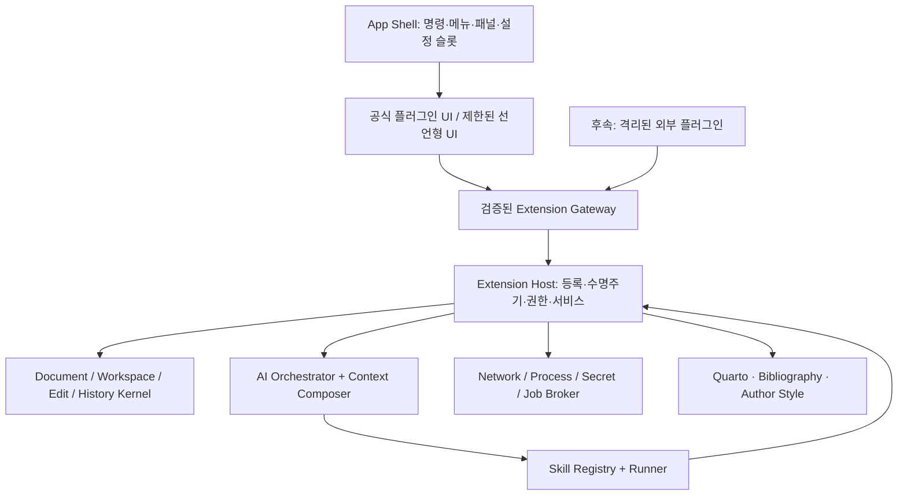

# ScholarPen Plugin & Skill System 전환 계획

작성일: 2026-11-11

기준: ScholarPen 1.9.0, 로컬 `main`의 `04d6d76`

상태: 설계 제안. 이 문서의 새 SDK, manifest, 명령, 경로는 구현 예정이며 현재 제공되는 API가 아니다.

범위: 플러그인 플랫폼, 스킬 실행 체계, 기존 기능의 단계적 이전, 저자 문체 학습 플러그인. 앱 구현·배포는 별도 후속 작업이다.

읽기 안내: 전체 방향은 1~4절, SDK·실행·권한은 5~11절, Quarto·참고문헌·문체 플러그인은 12~14절, 통계·AI writing score·Remove watermark + Humanize는 15~17절, 구현 순서와 검증은 19~22절에 정리했다.

## 1. 목표와 핵심 결정

ScholarPen을 **안정적인 학술 문서 코어 + 독립적으로 관리하는 기능 플러그인 + 작업 방법을 정의하는 스킬**로 전환한다. 새 기능을 추가할 때 `App.tsx`, `index.ts`, 전역 RPC와 설정 타입에 기능별 분기를 계속 추가하는 구조를 끝내는 것이 목적이다.

첫 전환은 기존 기능을 유지하는 모듈화에 집중한다. 같은 확장 지점을 공식 플러그인이 먼저 사용하고, 이후 검증된 격리 실행 환경을 통해 외부 플러그인의 설치·독립 업데이트까지 지원한다. 처음부터 모든 코드를 외부 패키지로 옮기는 전면 재작성은 하지 않는다.

| 결정 | 설계 방향 |
| --- | --- |
| 코어 | 문서 보존, 편집 트랜잭션, 저장·복구, 협업 동기화, 권한, 작업 관리, 확장 슬롯을 책임진다. |
| 플러그인 | UI·명령·도구·서비스·파일 처리·내보내기 등 실행 가능한 기능을 제공한다. |
| 스킬 | AI가 작업하는 절차·제약·입출력·필요 도구를 선언한다. 자체 실행 권한이나 파일 쓰기 권한은 없다. |
| 기본 제공 | 기존 사용자의 Quarto·참고문헌 등은 공식 번들 플러그인으로 계속 제공한다. 전환 직후 재설치시키지 않는다. |
| 우선 분리할 세 모듈 | `scholarpen.document-stats`, `scholarpen.ai-writing-score`, `scholarpen.text-cleanup`(Remove watermark + Humanize). |
| 함께 독립시킬 세 모듈 | `scholarpen.quarto`, `scholarpen.bibliography`, `scholarpen.author-style`. Quarto와 BibTeX를 하나의 출판 플러그인으로 합치지 않는다. |
| 문서 호환성 | 플러그인을 꺼도 기존 인용·수식·그림·각주·교차참조·제안·댓글을 열고 보존할 수 있어야 한다. |
| 문체 학습 | 기존 저자 편집 선호 학습을 분리·확장한다. 검토 가능한 프로필과 예문 검색을 우선하고 모델 미세조정은 후속 선택지로 둔다. |
| 외부 코드 | 일반 Bun 프로세스/Worker를 보안 샌드박스로 취급하지 않는다. 외부 임의 JS는 격리 검증 전까지 받지 않는다. |
| 확장성 기준 | 이미 공개한 확장 지점 안의 새 기능은 플러그인 파일과 테스트만으로 추가할 수 있어야 한다. 새로운 종류의 확장 지점은 의도적인 코어 API 변경으로 처리한다. |

### 1.1 완료의 의미

- Quarto와 BibTeX 관리 기능을 각각 끄고 켤 수 있으며 코어 편집·저장은 계속 작동한다.
- 통계·AI writing score·Remove watermark + Humanize도 각각 독립적으로 끄고 켠다. 통계와 문자 정리는 모델 설치나 AI 연결 없이 사용할 수 있다.
- 문체 플러그인은 사용자가 지정한 글과 편집 행동에서 프로필을 만들고, 이후 작성·교정에 같은 정책으로 적용한다.
- 작은 새 플러그인과 스킬을 추가할 때 앱의 기능별 `switch`, 전역 설정 필드, 개별 RPC 메서드를 수정하지 않는다.
- 플러그인 오류·삭제·업데이트 실패가 원고나 다른 플러그인의 데이터를 손상시키지 않는다.
- 외부 설치 지원 단계에서는 앱 재빌드 없이 호환 플러그인을 설치·업데이트한다.
- 모든 기능을 플러그인으로 분리했다는 선언보다, 기존 프로젝트의 데이터 무손실과 유지보수 경계가 검증되어야 한다.

## 2. 조사 결과와 현재 출발점

### 2.1 Textus에서 참고할 부분

사용자가 준 두 링크는 동일한 확장 페이지다. 해당 페이지의 Plugins와 Skills, 연결된 공식 개발 가이드를 함께 확인했다. Textus는 기능 확장과 AI 작업 지침을 구분하며, manifest로 명령과 UI 기여를 등록하고 필요할 때 활성화한다. 설치 시 권한을 보여 주고 등록한 자원은 비활성화 시 회수하는 구조다. 이는 ScholarPen이 채택할 설계 원칙이다. [확장 갤러리](https://textus.md/ko/extensions/#plugins), [플러그인 가이드](https://github.com/CatVinci-Studio/Textus/blob/main/docs/dev/plugins/guide.md)

Textus의 선언형 UI와 제한된 API 접근은 참고하되, ScholarPen에는 학술 문서의 구조 보존, Yjs/ProseMirror 기반 수정 이력, 외부 Quarto 실행, 저자 문체 프로필이라는 별도 요구가 있다. 따라서 Textus 플러그인 ABI와의 호환성을 목표로 하지 않고 ScholarPen 전용 계약을 만든다. 가이드와 내부 레지스트리 문서 사이에는 설명 범위 차이가 있으므로 내부 문서의 과거 제약을 현재 제품 전체의 제약으로 일반화하지 않는다. [내부 레지스트리](https://github.com/CatVinci-Studio/Textus/blob/main/docs/dev/plugin-api.md), [권한 정의](https://github.com/CatVinci-Studio/Textus/blob/main/docs/dev/plugins/permissions.md)

### 2.2 저장소에서 확인한 사실

로컬 파일·브랜치·현재 저장된 remote-tracking refs와 커밋 메시지를 조사했으나, 앱 전체의 플러그인 전환 계획이나 범용 플러그인 로더는 발견하지 못했다. 다른 컴퓨터의 미커밋·미푸시 작업과 갱신되지 않은 원격 브랜치까지 없다고 단정할 수는 없다. `docs/quarto-extension-formats-plan.md`는 **Quarto 자체 확장 포맷** 계획이며 ScholarPen 앱 플러그인 플랫폼 계획과는 다르다.

`PLAN.md`와 `AGENTS.md` 일부 상태 설명은 실제 코드보다 오래되어 있다. 아래 설계는 현재 구현을 우선한다.

| 영역 | 현재 코드 근거 | 전환 시 의미 |
| --- | --- | --- |
| 앱 조립 | `src/bun/index.ts` 882줄, `src/renderer/App.tsx` 1,017줄 | 기능별 import·RPC·UI 상태가 중앙에 모인다. composition root로 축소한다. |
| 에디터·AI | `EditorArea.tsx` 1,021줄, `AISidebar.tsx` 1,457줄 | 명령·도구·패널 기여를 확장 슬롯으로 교체한다. 줄 수 자체를 성공 지표로 삼지는 않는다. |
| 파일·설정 | `src/bun/fs/manager.ts` 1,206줄 | 일반 저장과 참고문헌·프로젝트 메모리 책임을 분리해야 한다. |
| RPC | `src/shared/scholar-rpc.ts`, `src/renderer/rpc.ts` | 코어 RPC는 유지하고 플러그인용 검증된 호출 통로를 추가한다. |
| 별도 handlers | `src/bun/rpc/handlers.ts` | 이 파일만 수정해서는 충분하지 않다. 실제 대규모 등록 지점은 `src/bun/index.ts`다. |
| Quarto | `src/bun/quarto/*`, `src/shared/quarto-*`, `Quarto*Dialog.tsx`, `App.tsx` | CLI 실행·설정·포맷 탐색·UI가 여러 층에 분산되어 있다. |
| 참고문헌 | `src/bun/citation/*`, `src/shared/bibtex-utils.ts`, `BibtexEditor.tsx`, `fs/manager.ts` | 정규 파일 경로, 외부 수정 충돌 검사, 검증·중복 제거를 모두 이전해야 한다. |
| 문서 모델 | `src/renderer/blocks/schema.ts`, `src/shared/collab/schema-spec.ts` | Quarto 관련 heading/table 속성과 citation 등이 영속 스키마에 들어 있다. 무작정 제거하면 안 된다. |
| 협업·이력 | `src/bun/collab/*`, `src/renderer/collab/*` | JSON뿐 아니라 `.scholarpen/collab/*.ydoc`와 이력을 함께 보존해야 한다. |
| 기존 스킬 | `src/bun/agent/skill-registry.ts`, `app-skills.ts`, `context-builder.ts` | 앱·프로젝트 스킬 검색, 이름 우선순위, slash 선택과 프롬프트 주입은 이미 존재한다. |
| 기존 저자 학습 | `src/bun/memory/learning.ts`, `sources.ts`, `runtime.ts`, `sync.ts` | 편집 관찰 기반 선호를 학습하나 Hindsight 동기화가 학습 실행도 담당한다. |
| 고정 문체 규칙 | `src/shared/ai-writing-style.ts`, `ai-punctuation.ts` | 개인 문장부호 선호가 여러 프롬프트·보정 경로에 고정되어 있다. 설정과 정책으로 이전해야 한다. |
| AI 공급자 | `src/bun/agent/providers.ts`, `codex/*`, `claude/*`, `ollama/*` | Ollama 전용 앱이 아니다. 공급자별 인증·스트리밍 차이를 보존해야 한다. |
| 런타임 | `package.json`, `electrobun.config.ts` | 선언된 의존성은 Electrobun `^1.16.0`, BlockNote `^0.47.3`, React 19. 빌드는 `--env=stable`, macOS `bundleCEF: false`다. |

### 2.3 유지해야 할 기존 계약

1. 프로젝트의 정규 참고문헌은 **`exports/references.bib`**다. 같은 이름의 drafts/resources 파일을 대신 열거나 덮어쓰지 않는다.
2. `documents/*.scholarpen.json`, `.scholarpen/collab`, 히스토리, 리뷰 작업본과 그림 경로를 갑자기 새 포맷으로 바꾸지 않는다.
3. AI 수정은 보호 구간·인용·수식·수치·언어·용어를 지키고 기존 수락·거절·undo·리뷰 흐름을 통한다.
4. 문서 전체를 읽는 권한과 실제로 수정하는 선택 범위는 구분한다.
5. AI 공급자 자격증명을 renderer 또는 외부 플러그인에 전달하지 않는다. 현재 저장 방식 점검과 비밀 저장소 이전은 호스트 작업으로 추적한다.
6. 사용자 지정 프로젝트 루트, `SCHOLARPEN_HOME`, 프로젝트별 설정과 수정 사본의 별도 작업 범위를 유지한다.
7. 브라우저 mock, 소스 테스트, 릴리스 빌드, 실제 설치된 앱의 확인은 서로 다른 검증 단계로 기록한다.

## 3. 코어·플러그인·스킬의 경계

### 3.1 코어에 남길 기능

| 코어 서비스 | 책임 | 제외할 기능 정책 |
| --- | --- | --- |
| Document Kernel | 영속 스키마, 파서·직렬화 무손실, 문서 ID·버전, 보호 구간 | 특정 저널의 서식, 문체 추론 |
| Edit & Review Kernel | 변경 제안, 수락·거절, 트랜잭션, 댓글 anchor, undo, CRDT 일관성 | 심사 전략·리뷰어 페르소나 |
| Workspace Service | 프로젝트·파일 핸들, 경로 검증, 원자 저장, 변경 감시 | BibTeX 정리·자료 검색 |
| History & Recovery | 복구 체크포인트, 이력 저장, 복원 | 고급 이력 비교 패널은 나중에 확장 가능 |
| App Shell | 창·탭·레이아웃·접근성·공통 UI·설정 컨테이너 | Quarto/BibTeX 전용 다이얼로그 |
| Extension Host | manifest 검증, 로딩, 권한·호환성·수명주기·서비스 중개 | 플러그인별 도메인 로직 |
| AI Orchestrator | 요청 목적, 모델 선택, 컨텍스트 합성, 도구 권한, 취소, 사용량 | 문체 학습·검색 전략·교정 레시피 |
| Job/Secret/Network/Process Broker | 장시간 작업, 비밀 참조, 허용된 네트워크와 외부 실행 | 플러그인에 임의 shell·전체 환경변수 노출 |

본문에 이미 저장된 `citation`, `crossReference`, `inlineMath`, `figure`, `footnote`, `note`, `quartoLiteral`과 heading/table 속성은 코어의 **문서 호환 계층**이 계속 이해한다. 참고문헌 검색 UI나 Quarto 속성 편집 UI를 플러그인으로 옮기는 것과 저장 포맷을 없애는 것은 다르다.

### 3.2 플러그인 후보와 순서

| ID | 기능 | 도입 순서 | 의존 관계 |
| --- | --- | --- | --- |
| `scholarpen.document-stats` | 글자·단어·문단·선택 범위 통계 | P1a, 첫 독립 제품 기능 | 코어 문서 읽기, 모델 불필요 |
| `scholarpen.ai-writing-score` | AI writing score와 DetectorScope 설치·실행·결과 | P1b | 호스트 관리 Python runtime, LLM 공급자 불필요 |
| `scholarpen.text-cleanup` | Remove watermark + Humanize, 독립된 두 실행 모듈 | P1c | 문자 정리는 로컬, Humanize만 AI·제안 API 사용 |
| `scholarpen.quarto` | 조판, 책 설정, 포맷·템플릿, 렌더 작업 | P2, 독립 출판 plugin | 코어 export/process, 참고문헌 서비스는 선택 |
| `scholarpen.bibliography` | BibTeX 편집, DOI, 검색, 병합·정리·검증 | P3, 독립 참고문헌 plugin | 코어 파일·트랜잭션, AI는 선택 |
| `scholarpen.author-style` | 저자 문체 프로필, 샘플·편집 학습, AI 적용 | 초기 출시의 필수 범위 | 코어 관찰 이벤트·AI context, Hindsight는 선택 |
| `scholarpen.research` | OpenAlex/PubMed/웹 검색과 증거 정리 | 후속 | 검색 provider 계약 |
| `scholarpen.citation-evidence` | 주장과 인용 원문 대조 | 후속 | bibliography/source 서비스 |
| `scholarpen.review-workflow` | 가상 심사·실제 심사의견 대응·답변서 | 후속 | 코어 제안/작업, source·bibliography 선택/필수 기능별 구분 |
| `scholarpen.project-memory` | Hindsight 연결·검색·동기화 | 후속, 문체 분리와 함께 접점 추출 | 코어 storage/network, 문체와 순환 의존 금지 |
| `scholarpen.provider-*` | Ollama/Claude/Codex 등 provider adapter | 마지막 | 인증·프로세스 호스트 서비스 |

전부 미세한 플러그인으로 쪼개지 않는다. 같은 상태·트랜잭션을 공유하는 기능은 한 모듈로 유지한다. provider는 문서 기능 이전과 동시에 뜯어고치지 않는다.

이전 초안의 `scholarpen.detectorscope`와 `scholarpen.writing-tools`는 각각 `scholarpen.ai-writing-score`와 `scholarpen.text-cleanup`으로 설계명을 확정한다. 아직 배포된 plugin ID를 바꾸는 migration은 아니다. AI writing score는 제품 기능명, DetectorScope는 현재의 내부 engine이며 이후 engine adapter가 바뀌어도 제품 ID는 유지한다.

### 3.3 스킬과 콘텐츠 팩

- **Plugin**: 실행 코드와 등록 가능한 기능. 예: Quarto 렌더러, 참고문헌 검증 도구.
- **Skill**: 작업 목적·지침·출력 계약·필요 도구. 예: 저널 제출 준비, 내 문체로 초안 작성.
- **Content pack**: CSL, 템플릿, 저널별 YAML, 스킬·예문 등의 데이터 묶음. 코드 실행 없이 설치할 수 있다.
- **Quarto extension**: Quarto가 읽는 `_extensions` 패키지. ScholarPen 플러그인과 별도 버전·별도 신뢰 대상으로 관리한다.
- **Model/provider adapter**: AI 호출 방식을 구현하는 신뢰 코드. 일반 스킬이 공급자의 인증 세션이나 shell을 얻지 않는다.

## 4. 목표 아키텍처와 실행 모델



### 4.1 두 단계 런타임

**Runtime A: 공식 번들 플러그인, 첫 출시.** Bun 로직과 React UI를 앱 빌드에 포함하고 generated registry가 lazy import한다. 기존 기능은 신뢰 코드이므로 같은 프로세스에서 시작할 수 있다. 이 단계의 권한 broker는 일관된 계약·감사·실수 방지용이며, 악성 in-process 코드를 차단하는 보안 경계라고 설명하지 않는다. 렌더링·Python 분석 등 무거운 작업은 호스트가 관리하는 별도 프로세스로 보낸다.

**Runtime B: 독립 설치형 확장.** 외부 JS는 호스트 전역·Bun·Node·DOM에 직접 접근할 수 없는 실행 환경에서 구동한다. 우선 PoC는 제한된 browser frame/runtime와 메시지 broker이며, API가 충분한지는 실제 WKWebView 릴리스에서 검증한다. 표준 명령·폼·목록은 호스트가 그린다. 임의 React 컴포넌트를 앱의 renderer에 동적 import하는 방식은 외부 플러그인에 제공하지 않는다.

Electrobun의 `sandbox`는 앱 RPC 비활성화와 관련된 기능이지, 임의 Bun 코드·파일·네트워크 전체를 격리해 주는 보장은 아니다. 최신 공식 문서는 현재 저장소의 1.16 계열과 API가 다를 수 있다. 필요한 격리 기능은 **설치된 버전 확인과 PoC 결과**로 채택한다. [Electrobun webview architecture](https://github.com/blackboardsh/electrobun/blob/main/docs/src/content/docs/electrobun/guides/architecture/webview-tag.mdx)

| 배포 단계 | 앱 재빌드 | 설치 가능한 확장 | 한계 |
| --- | --- | --- | --- |
| A | 공식 코드 변경 시 필요 | 번들 공식 플러그인, 검증된 스킬·데이터 팩 | 기능 모듈화는 달성하나 외부 임의 코드 독립 설치는 아직 아님 |
| B | 호환 API 범위 내 불필요 | 격리된 JS 플러그인, 스킬·데이터 팩 | native 실행·custom schema는 계속 제한 |
| 후속 | 코어 API 변경 시만 필요 | 별도 심사한 native integration | 서명만으로 sandbox가 되지는 않음 |

### 4.2 의존 방향

- 코어는 SDK 계약만 알며 `plugins/quarto` 같은 구현을 import하지 않는다. composition root/generated catalog만 예외다.
- 플러그인은 `@scholarpen/plugin-sdk`와 자신의 파일만 import한다. `src/bun/fs/manager.ts`, 다른 플러그인 내부 경로를 직접 import하지 않는다.
- 서비스는 `scholarpen.bibliography.catalog@1`처럼 버전이 있는 계약으로 발견한다. 필수·선택 의존성을 구분하고 순환 의존은 설치 전에 거부한다.
- 동일 서비스의 제공자가 여럿이면 사용자 선택 또는 명시적 우선순위로 결정한다. 마지막 등록자가 조용히 덮어쓰지 않는다.
- 최초 버전은 앱 세션당 동일 ID의 플러그인 버전 하나만 활성화한다. 여러 프로젝트의 version 요구가 충돌하면 알리고 해당 프로젝트에서 제한한다. 몰래 다른 버전으로 실행하지 않는다.

### 4.3 API 호환 정책

SDK 1.0 공개 전까지는 experimental API를 명시하고 공식 plugin과 함께 변경할 수 있다. 공개 이후 minor는 추가 중심, 제거·의미 변경은 major로 처리한다. deprecation은 최소 두 번의 stable 앱 릴리스 동안 경고·adapter를 유지하는 것을 기본 정책으로 삼되 보안 문제가 있으면 더 빨리 차단할 수 있다.

host는 지원 API 범위와 capability 목록을 알리고 plugin은 실제 요구 범위를 선언한다. “타입 검사가 통과함”과 “현재 host에서 지원함”을 구분한다. CI에 최소 지원 host API와 최신 host API의 contract matrix를 두고, 지원하지 않는 조합은 활성화 전에 설명한다. migration API는 문서 API와 따로 버전 관리한다.

## 5. 플러그인 패키지와 manifest

### 5.1 권장 패키지 구조

```text
plugins/quarto/
  scholarpen.plugin.json
  src/main.ts                 # 공식 Bun 로직, 호스트 SDK 사용
  src/ui.tsx                  # 공식 React 슬롯 구현
  src/contracts.ts            # 서비스 입출력, 검증 스키마
  src/render-job.ts
  schemas/settings.json
  skills/prepare-submission/SKILL.md
  templates/
  locales/ko.json
  locales/en.json
  migrations/
  tests/
  README.md
  LICENSE
```

### 5.2 Manifest v1 제안 예시

아래 JSON은 제안된 스키마의 예시다. `trust`는 manifest에 쓰지 않는다. 공식 신뢰 여부는 호스트의 배포 출처·서명 정책으로 결정한다.

```json
{
  "manifestVersion": 1,
  "id": "scholarpen.quarto",
  "name": "Quarto Publishing",
  "version": "1.0.0",
  "publisher": "scholarpen",
  "license": "MIT",
  "engines": { "scholarpenApi": "^1.0.0" },
  "entrypoints": {
    "main": "dist/main.js",
    "ui": "dist/ui.js"
  },
  "activationEvents": [
    "onCommand:scholarpen.quarto.render",
    "onView:scholarpen.quarto.project-settings"
  ],
  "permissions": [
    { "capability": "document.read", "scope": "project" },
    { "capability": "workspace.read", "paths": ["exports/**", "figures/**"] },
    { "capability": "workspace.write", "paths": ["exports/**"] },
    { "capability": "process.tool", "tool": "quarto" }
  ],
  "optionalServices": [
    { "id": "scholarpen.bibliography.catalog", "version": "^1.0.0" }
  ],
  "contributes": {
    "commands": [
      { "id": "scholarpen.quarto.render", "title": "%render%", "when": "projectOpen" }
    ],
    "views": [
      { "id": "scholarpen.quarto.project-settings", "slot": "project.tools", "title": "%projectSettings%" }
    ],
    "exporters": [
      { "id": "scholarpen.quarto.publish", "formats": ["quarto-project"], "command": "scholarpen.quarto.render" }
    ],
    "skills": ["skills/prepare-submission/SKILL.md"]
  },
  "settingsSchema": "schemas/settings.json",
  "dataSchemaVersion": 1,
  "locales": { "ko": "locales/ko.json", "en": "locales/en.json" }
}
```

### 5.3 스키마 규칙

- ID는 `publisher.name`, 기여 ID는 `<pluginId>.<localName>` 형식이며 전역적으로 유일하다.
- `manifestVersion`, 플러그인 버전, host API 버전, 데이터 스키마 버전을 별개로 관리한다.
- `entrypoints`는 `main`, `ui`, `sandbox` 중 허용된 조합으로 검증한다. 외부 배포물의 `main`/공식 React `ui` 요청은 거부한다. 데이터 전용 패키지는 entrypoint가 없다.
- JSON Schema와 런타임 검증을 단일 계약에서 생성한다. 알 수 없는 권한·기여 유형은 무시하지 않고 설치 실패로 표시한다.
- 경로는 패키지 내부 상대경로만 허용한다. 절대경로·`..`·탈출 symlink·크기 초과·압축 폭탄을 차단한다.
- `when`은 제한된 조건식 parser로 평가한다. `eval`이나 JavaScript 함수 문자열을 허용하지 않는다.
- manifest를 읽는 것만으로 코드가 실행되지 않아야 한다. 메뉴·설정 설명은 비활성 상태에서도 확인할 수 있다.
- 플랫폼·아키텍처·외부 CLI 요구사항은 별도 `requirements`로 기술한다. 앱 API 호환과 도구 설치 상태를 혼동하지 않는다.

## 6. SDK, 기여 지점, RPC 계약

### 6.1 공개 기여 지점

| 확장 지점 | 용도 | 제한 |
| --- | --- | --- |
| `commands` | 명령 팔레트·단축키·메뉴의 공통 실행 ID | 입력 스키마·권한·활성 조건을 실행 직전에 재검증 |
| `menus` | editor slash/context/toolbar, file context, app tools | 임의 DOM 삽입 금지, 충돌 규칙과 정렬 그룹 정의 |
| `views` | sidebar, project tools, document auxiliary pane | 호스트 레이아웃·접근성·오류 경계 안에서 렌더 |
| `statusItems` | 글자·단어 수 등 상태 막대 항목 | 코어 저장 상태와 영역 분리, 계산은 plugin, 비활성 시 회수 |
| `resultRenderers` | score·정리 결과 같은 Activity/Assistant 카드 | 결과 type/version으로 연결, plugin off 때 안전한 Markdown fallback |
| `documentActions` | 문서·선택 범위의 명시적 작업 | command·scope·job·result 계약, action별 코어 분기 추가 금지 |
| `fileHandlers` | `.bib` 등 파일 열기·미리보기 | 경쟁 시 사용자 선택, 원본 읽기 fallback |
| `settings` | 사용자·프로젝트 설정 | schema 기반 UI, 비밀값은 secret reference |
| `exporters` | 스냅샷을 파일·아티팩트로 변환 | 원본 문서에 부작용 없는 기본 계약 |
| `diagnostics` | 경고·오류·문제 위치 | 읽기 전용 결과와 수정 제안 분리 |
| `aiTools` | AI가 호출할 typed 도구 | 데이터 읽기·쓰기·네트워크의 실제 권한을 함께 검사 |
| `contextProviders` | 문체·검색·용어 등 요청별 컨텍스트 | 목적·우선순위·예산·출처를 가진 구조화된 결과 |
| `services` | 플러그인 간 기능 제공 | 버전 있는 입출력, host broker 경유 |
| `skills` | 작업 레시피 | capability 부여 없음, tool 의존성이 없으면 실행 불가 |
| `documentExtensions` | 후속 custom block/inline | 첫 버전에서는 외부 등록 금지, 11절 호환성 검증 후 개방 |

### 6.2 호스트 SDK의 표면

다음은 개념 계약이며 즉시 컴파일할 수 있는 구현 코드는 아니다. `DocumentSnapshot` 등 참조 타입과 런타임 스키마는 SDK 작업에서 함께 정의한다.

```typescript
interface PluginContext {
  readonly plugin: { id: string; version: string };
  readonly subscriptions: DisposableStore;
  readonly commands: CommandRegistry;
  readonly services: ServiceRegistry;
  readonly documents: DocumentReadAndProposalAPI;
  readonly workspace: ScopedWorkspaceAPI;
  readonly jobs: JobAPI;
  readonly actions: DocumentActionRegistry;
  readonly results: ResultStoreAPI;
  readonly settings: ScopedSettingsAPI;
  readonly storage: ScopedStorageAPI;
  readonly ai: AIRequestAPI;
  readonly context: ContextProviderRegistry;
  readonly tools: ToolRegistry;
  readonly log: RedactedLogger;
}

interface ScholarPlugin {
  activate(context: PluginContext): Promise<void> | void;
  deactivate?(): Promise<void> | void;
}

type EditResult =
  | { kind: "proposed"; proposalId: string }
  | { kind: "conflict"; currentRevision: string }
  | { kind: "denied"; reason: string };
```

호스트 발급 `ProjectHandle`, `DocumentHandle`, `FileHandle`을 사용하고 플러그인이 임의 절대경로를 권한처럼 넘기지 못하게 한다. 핸들은 세션·프로젝트·권한에 묶이며 프로젝트 전환이나 권한 철회 시 만료된다. TypeScript branded type만으로 보안을 보장하지 않고 런타임 소유권을 검사한다.

### 6.3 플러그인 RPC 통로

기존 `ScholarRPC`에 기능마다 메서드를 추가하는 대신 플랫폼용 통로를 한 번 도입한다. 후보는 `extensions.list`, `extensions.invoke`, `extensions.cancel`, `extensions.setEnabled`, `extensions.events`다. 실제 Electrobun schema에 맞춘 이름은 구현 시 확정한다.

- 호출 envelope: `protocolVersion`, `requestId`, `operation`, `args`. 발신 주체와 허용 scope는 연결 세션에서 호스트가 붙인다.
- UI에 보이는 `pluginId`는 라우팅 정보일 뿐 인증 정보가 아니다. 외부 frame이 다른 ID를 주장해 권한을 얻지 못한다.
- 요청·응답 모두 operation별 schema로 검사하고 메시지 크기·동시 실행 수·timeout을 제한한다.
- 장시간 요청은 `jobId`를 반환한다. 진행률·로그·완료는 순번 있는 event로 전달하고 재연결은 현재 job snapshot과 마지막 순번으로 복구한다.
- 취소는 renderer의 `AbortSignal` 객체를 직렬화하지 않고 `requestId/jobId`에 대한 명시적 메시지로 전달한다.
- 오류는 `UNAVAILABLE`, `INCOMPATIBLE`, `DENIED`, `CONFLICT`, `CANCELLED`, `TIMEOUT`, `FAILED`로 분류한다. 원고·토큰·전체 파일 경로를 일반 로그에 남기지 않는다.
- 동일 작업 재시도의 idempotency key를 지원한다. 쓰기·설치·render를 통신 재시도만으로 중복 실행하지 않는다.
- 서비스 간 호출은 호출자와 제공자 권한을 함께 검사한다. 제공자가 가진 넓은 권한을 다른 플러그인이 우회 이용하지 못하게 한다.

외부 runtime의 연결은 호스트가 만든 세션별 channel에 묶는다. sandbox frame에서 origin이 `null`일 수 있으므로 문자열 origin 검사만으로 식별하지 않는다. 실제 frame/window·전용 MessagePort·발급 nonce를 확인하고 frame 교체/disable 시 채널을 폐기한다. CSP는 fetch뿐 아니라 image/media/form/navigation 등을 통한 전송도 제한한다. 이 통로가 Electrobun의 기본 privileged RPC를 노출하지 않는지는 P0/P6 실제 앱 테스트로 입증해야 한다.

### 6.4 이벤트와 편집 트랜잭션

핵심 이벤트는 `document.saved`, `document.changed`, `editor.selectionChanged`, `edit.proposed`, `edit.decided`, `author.editObserved`, `project.opened/closed`, `plugin.stateChanged`, `job.updated`다. 이벤트에는 범위·revision·origin·correlation ID가 포함된다.

`origin`은 호스트가 생성한 `human`, `ai`, `plugin`, `import`, `undo`, `migration`으로 구분한다. 플러그인이 스스로 `human`이라고 주장할 수 없다. 쓰기 요청은 `baseRevision`, 대상 block/range, 변경 이유, 기대한 보호 토큰을 포함한다. 호스트는 범위·충돌·보호 구간을 검증하고 제안 또는 허용된 트랜잭션으로 적용한다. Y.Doc·ProseMirror 객체 자체는 외부에 넘기지 않는다.

초기 세 plugin을 위해 `DocumentSnapshot`에 revision·accepted/proposed view·block/range source map을 공통 제공한다. 통계의 집계 대상, detector의 대괄호 제외, cleanup의 문자 정책은 각 plugin이 별도 projection으로 선택한다. 하나의 가공된 문자열을 모든 기능에 강제하지 않는다.

새 작업은 versioned `extensionAction` envelope에 command ID·scope·job/result reference를 저장하고 코어가 소유권·실행 상태를 검증한다. 기존 `ThreadMeta.documentAction` 문자열과 Markdown 결과는 legacy reader로 유지한다. 결과 envelope에는 안전한 Markdown fallback을 필수로 두고 전문 renderer가 없어도 읽을 수 있게 한다. comment thread가 필요 없는 status 통계까지 AI 댓글로 만들지 않는다.

## 7. 수명주기와 장애 처리

```text
discovered → validated → installed-disabled → enabled-idle
  → activating → active → deactivating → enabled-idle / disabled
검증 실패 → incompatible / quarantined
실행 실패 → failed → 명시적 재시도 또는 제한된 복구
```

1. 시작 시 manifest만 읽어 명령·설정·뷰 설명을 등록한다. 실제 코드는 최초 기능 사용 때 로드한다.
2. 활성화는 플러그인당 하나의 Promise로 합친다. 의존 서비스부터 위상 순서로 시작하고 실패 시 부분 등록을 회수한다.
3. register/subscribe는 모두 disposable을 반환한다. unload 시 listener·timer·패널·서비스·작업 참조를 정리한다.
4. disable 요청은 새 작업을 막고 실행 중 작업을 취소하거나 종료를 기다린다. 미저장 `.bib` 편집이 있으면 저장·폐기·취소 선택을 제공한다.
5. 문서 쓰기·DB migration 도중 프로세스를 무조건 죽이지 않는다. 안전 경계까지 대기하고 journal을 복구한다. 강제 종료가 필요한 경우 다음 시작에서 복구한다.
6. 외부 sandbox hang는 host watchdog가 종료한다. in-process 공식 코드의 동기 무한 루프는 timer로 끊을 수 없으므로 같은 격리 보장을 하지 않는다.
7. 반복 crash는 해당 플러그인을 격리한다. Safe Mode에서는 optional 플러그인 코드를 로드하지 않고 문서를 연다.
8. plugin disable과 uninstall은 문서·참고문헌·렌더 결과·프로필 데이터를 자동 삭제하지 않는다. 데이터 삭제는 별도 동작이다.

## 8. 권한과 신뢰 모델

| 권한 계열 | 허용할 범위 |
| --- | --- |
| `document.read` | 선택 영역, 활성 문서, 명시적으로 허용한 프로젝트 문서 |
| `document.propose` | 지정 문서·범위의 변경 제안 |
| `document.apply` | 직접 수정이 허용된 작업, 호스트 트랜잭션 필수 |
| `workspace.read/write` | 허용된 project-relative 경로 또는 사용자 선택 파일 핸들 |
| `network` | scheme/host/port와 허용 작업, redirect마다 재검증 |
| `process.tool` | 호스트가 등록한 도구의 typed 실행 요청 |
| `ai.request` | 허용된 provider로 지정 목적의 모델 호출, 자격증명 접근 제외 |
| `author.observations.read` | 사용자 동의한 저자 편집 관찰 |
| `author.profile.read/write` | 지정 author/profile scope |
| `storage.project/global` | 해당 플러그인의 namespace |

권한은 설치 시 필요한 기능과 함께 제시하고 최초 사용에 맞춰 승인할 수 있게 한다. 이미 허용한 동일 scope의 작업마다 반복 확인하지 않는다. 업데이트가 권한을 넓힐 때만 변경점을 보여 준다. 프로젝트에 포함된 manifest나 스킬을 열었다는 이유로 실행 권한이 생기지 않는다.

네트워크 broker는 localhost·사설망 접근을 별도로 관리한다. 파일 broker는 canonical path·symlink·쓰기 직전 경로·충돌을 검증한다. secret은 namespace별 handle로 참조하고 다른 플러그인의 secret을 읽지 못한다. stdout/stderr·오류·진단에서도 비밀을 가린다.

외부 도구는 `[executable, ...args]`로 실행하고 임의 shell 문자열을 받지 않는다. 다만 **Quarto 문서 자체의 코드·Lua filter·pre/post-render는 별도의 코드 실행 경로**이므로 argv 검증만으로 안전하다고 볼 수 없다. 12절의 프로젝트 신뢰 정책을 적용한다. [Quarto project scripts](https://quarto.org/docs/projects/scripts.html)

## 9. Skill System 기본 설계

### 9.1 기존 기능을 확장하는 방식

현재 `skill-registry.ts`는 앱의 `skills/`, `commands/`와 프로젝트 `.scholarpen/skills/`, `.scholarpen/commands/`를 탐색한다. 같은 이름이면 프로젝트 항목을 우선하며, 선택한 내용을 최대 12,000자로 잘라 프롬프트에 넣는다. `app-skills.ts`는 기본 스킬을 파일로 만들고 사용자의 Claude command를 최초 복사하기도 한다.

새 체계는 이 파일들을 삭제하지 않고 **legacy adapter**로 읽는다. 기존 `/academic-review` 같은 이름은 alias로 유지한다. 새 스킬은 경로 대신 안정된 ID와 버전을 사용하며, 설명·입출력·필요 도구를 명시한다. 기존 파일의 소유자·출처·검토 여부를 보여 주고 외부 commands 복사를 무조건 신뢰된 스킬 등록으로 간주하지 않는다.

### 9.2 SKILL.md 형식 제안

```yaml
---
schemaVersion: 1
id: scholarpen.author-style.write-in-my-style
name: 내 문체로 쓰기
version: 1.0.0
description: 승인한 문체 프로필을 사용해 새 글 또는 수정 제안을 작성한다.
inputs:
  source: [selection, active-document, explicit-prompt]
requires:
  services:
    - id: scholarpen.author-style.profile
      version: ^1.0.0
  tools:
    - scholarpen.author-style.resolve-profile
    - core.document.propose
context:
  maxTokens: 1600
  include: [selection, document-outline, active-style-profile]
output:
  kind: proposed-edit
  schema: core.document-patch.v1
invocation:
  explicit: true
  suggest: true
---

# 절차
1. 요청의 언어·장르·범위에 맞는 프로필을 확인한다.
2. 자료에 없는 사실을 추가하지 않고 초안 또는 수정안을 만든다.
3. 인용·수치·수식·불확실성 표현을 보존한다.
4. 적용한 규칙 ID와 수정 제안을 반환한다.
```

이 형식은 일반 Markdown 기반 스킬의 가져오기를 돕지만 Claude/Codex 등 외부 도구의 SKILL.md와 완전한 실행 호환을 보장하지 않는다. 외부 스킬의 shell 지시는 텍스트로 보존할 수 있어도 자동 실행하지 않는다.

### 9.3 실행 절차

`선택/추천 → manifest·도구 의존 검사 → 컨텍스트 범위 결정 → 목적별 prompt 합성 → 제한된 tool loop → 출력 검증 → 제안/아티팩트 → 사용자 수락 또는 허용된 실행`

- 스킬은 필요한 도구를 요청할 뿐 권한을 부여하지 못한다. 스킬·caller·plugin·프로젝트 정책의 허용 범위를 모두 만족해야 한다.
- AI의 “도구를 사용했다”는 문장은 실행 증거가 아니다. tool result와 job receipt만 완료 근거로 삼는다.
- 모델별 tool calling은 provider capability로 판단한다. 지원하지 않는 provider에는 검증 가능한 호스트 실행 흐름을 쓰거나 기능 제한을 표시한다.
- 문서·웹·예문·스킬 안의 숨은 지시가 호스트 권한과 보호 정책을 바꾸지 못하게 한다.
- 토큰 예산 초과는 조용한 문자열 절단 대신 요약/제외 목록을 남긴다. 필수 절차·출력 schema를 중간에서 자르지 않는다.
- 단계·도구 횟수·시간·비용 상한과 취소를 갖는다. 자동 재시도가 새 문서 수정으로 확대되지 않는다.
- 같은 이름의 충돌은 `publisher.skill`로 구분한다. 프로젝트 override는 UI에서 명시적으로 매핑하며 공식 스킬을 조용히 가리지 않는다.
- 스킬 추천은 활성 권한·언어·문서 상태를 고려하지만 자동 실행으로 이어지지 않는다.

### 9.4 초기 스킬 세트

| 스킬 | 기능 제공자 | 결과 |
| --- | --- | --- |
| `academic-review` | writing/review | 근거와 위치를 가진 검토 의견 |
| `rewrite-section` | 코어 제안 + author-style 선택 | 보호 구간을 유지하는 수정안 |
| `prepare-submission` | quarto + bibliography 선택 | 누락 항목 검사, 조판 설정, 렌더 작업 |
| `clean-bibliography` | bibliography | 정리 계획·차이·적용 receipt |
| `learn-my-style` | author-style | 근거가 연결된 후보 프로필 |
| `write-in-my-style` | author-style | 요청 범위의 초안 또는 수정안 |
| `compare-style` | author-style | 프로필 적용 전후 비교, 의미 변경 위험 |
| `citation-check` | citation-evidence | 출처를 읽은 범위가 표시된 검증 결과 |
| `document-stats` | document-stats | 실제 계산 결과, 모델이 수를 추정하지 않음 |
| `ai-score` | ai-writing-score | 실제 DetectorScope report, 분석 실패 시 점수 없음 |
| `remove-watermark` | text-cleanup의 Unicode 모듈 | 직접 로컬 command, LLM 실행 없이 작업 receipt |
| `humanize` | text-cleanup의 Humanize 모듈 | 언어별 rulebook과 보호 정책을 적용한 수정안 |

`ai-score`는 현재의 실제 DetectorScope 도구에 연결한다. 스킬 프롬프트만 보고 모델이 점수를 지어내는 경로를 만들지 않는다.

## 10. 저장 위치, 설정, 설치·업데이트

### 10.1 저장소 구조 제안

기존 `src/` 전체를 먼저 옮기지 않고 플랫폼과 플러그인 디렉터리를 추가한다.

```text
packages/plugin-sdk/               # TypeScript 계약·schema·테스트 도구
src/shared/extensions/             # wire protocol, generated contracts
src/bun/extensions/                # manager, lifecycle, broker, registry
src/renderer/extensions/           # slots, UI adapters, extension settings
src/bun/core/                      # 단계적으로 추출하는 host services
plugins/
  document-stats/
  ai-writing-score/
  text-cleanup/
  quarto/
  bibliography/
  author-style/
  ...
scripts/extensions/                # validate, build, catalog, package
docs/plugins/                      # API 문서, 예제, migration guide
```

새 build script는 `plugins/*/scholarpen.plugin.json`을 검증해 catalog와 lazy importer를 생성한다. 수동으로 중앙 plugin 목록에 import를 추가하는 관행을 남기지 않는다. `package.json`의 workspace 등록과 `tsconfig` include/aliases 변경은 플랫폼 단계에서 한 번 수행하고 import 경계 검사를 추가한다.

### 10.2 런타임 데이터

| 종류 | 제안 경로/원칙 |
| --- | --- |
| 공식 번들 | 앱 Resources의 읽기 전용 extension assets, build copy 명시 |
| 설치 패키지 | 호스트 userData 아래 `extensions/<id>/<version>/` |
| 설치 원장 | userData의 `extensions/registry.json`, hash·출처·버전·상태 |
| 권한·신뢰 | userData의 호스트 전용 상태. 프로젝트에 복사하지 않음 |
| 플러그인 개인 데이터 | userData의 `extension-data/<id>/` |
| 프로젝트별 데이터 | `<project>/.scholarpen/plugins/<id>/` |
| 공유 문체 프로필 | userData의 `extension-data/scholarpen.author-style/profiles/` |
| 프로젝트 확장 요구 | `<project>/.scholarpen/extensions.json` |
| 프로젝트 사용 버전 | `<project>/.scholarpen/extensions.lock.json`, 버전·무결성·API 요구만 기록 |
| 기존 스킬 | 기존 앱/프로젝트 경로 유지, legacy adapter로 읽음 |

호스트 userData의 실제 macOS 경로는 Electrobun 버전과 현재 설치 상태를 확인해 확정한다. `~/ScholarPen/settings.json`과 프로젝트를 함께 옮기지 않는다. 확장 폴더를 기본 프로젝트 루트 아래 두어 가짜 프로젝트로 탐색하게 만드는 문제도 피한다. 테스트는 별도 `SCHOLARPEN_EXTENSIONS_HOME`과 `SCHOLARPEN_HOME`을 사용한다.

설정은 `default → user → project → request` 순으로 좁혀 적용한다. 프로젝트 설정이 개인·조직의 보안 제한을 완화하지 못한다. secret 값·절대경로·승인 기록은 project lock에 넣지 않는다. 문서에 필요한 확장 목록과 실행 허용은 별개다.

### 10.3 설치·업데이트 트랜잭션

`다운로드/폴더 선택 → 임시 압축 해제 → 경로·크기 검사 → schema·호환성·의존성 확인 → hash/출처 확인 → 권한 변경 표시 → 새 버전 준비 → 데이터 백업·migration → 활성 포인터 전환 → health check`

- 첫 플랫폼은 공식 번들 + 로컬 스킬/데이터 팩으로 시작한다. 공개 marketplace와 결제는 후순위다.
- 독립 배포에서는 registry가 해시·버전·publisher 출처를 제공하고 package signature를 검증한다. hash만으로 작성자 신원을 증명한다고 말하지 않는다.
- `postinstall`·임의 npm script·패키지 관리자 실행을 설치 과정에서 허용하지 않는다. 배포물은 사전 번들된 정적 자산이다.
- 업데이트 실패 시 이전 package pointer와 호환 데이터 snapshot으로 복구한다. 데이터 migration이 비가역이면 자동 downgrade를 막고 백업 복구 경로를 제공한다.
- registry 실패·오프라인 상태에서도 이미 설치된 호환 플러그인은 작동한다.
- 외부 plugin download를 app signing/notarization의 일부인 것처럼 표시하지 않는다. native 실행물·Python 모델은 별도 검증·버전·라이선스 대상으로 관리한다.
- 개발 폴더는 development 표식을 붙인다. 파일 변경 reload는 실행 중 작업과 문서 schema를 안전하게 정리한 뒤 수행한다.

## 11. 문서 무손실과 협업 호환성

### 11.1 초기 방침: 스키마 안정화

BlockNote의 custom schema는 에디터 생성에 사용된다. ScholarPen은 그 ProseMirror schema를 JSON으로 Bun peer에 전달한다. 그러므로 플러그인 UI를 끈다고 해당 node/mark를 제거하면 renderer뿐 아니라 AI peer의 읽기·쓰기까지 달라진다. 첫 단계에서는 영속 타입을 유지하며 schema hot-swap을 제공하지 않는다. [BlockNote custom schemas](https://github.com/typecellos/blocknote/blob/main/docs/content/docs/features/custom-schemas/index.mdx)

코어의 Markdown/QMD 읽기·내보내기는 기본 문서 교환 기능으로 남긴다. Quarto 플러그인이 없어도 기존 literal·속성·frontmatter를 보존한다. 자동 변환 과정에서 알 수 없는 YAML 필드나 사용자 주석을 지우지 않는다.

### 11.2 나중에 custom block을 개방할 조건

- 타입 ID·schema 버전·필요 renderer의 fingerprint를 문서 metadata에 기록한다.
- 선언형 저장 스키마와 실행 UI를 분리하고, 비활성화해도 최소 저장 스키마와 안전한 표시가 남게 한다.
- 미지원 plugin payload는 원본을 보존하는 opaque container와 fallback text로 처리한다. 임의 ProseMirror node를 일반 paragraph로 바꾸는 fallback은 금지한다.
- 기존 문서에 알 수 없는 node가 있고 무손실 인코딩을 검증하지 못했다면 읽기 전용으로 연다. 자동 저장을 막고 호환 앱/플러그인 필요성을 알린다.
- schema 변경은 문서를 닫거나 저장·재개방하는 경계에서만 적용한다. Yjs peers의 schema fingerprint가 다르면 쓰기 동기화를 중단한다.
- undo·댓글 anchor·suggestion marks·figure IDs를 포함한 round-trip을 통과해야 개방한다.

### 11.3 데이터 migration 원칙

사전 백업 → 새 위치/스키마에 복사 → 검증 → migration journal 완료 → 새 소유자 활성화 순서다. 원본 JSON·Y.Doc·bibliography를 한꺼번에 inplace 변경하지 않는다. 재실행은 idempotent해야 하며 중간 crash로 두 모듈이 동시에 writer가 되지 않게 한다.

이전 버전 앱도 함께 쓸 수 있는지는 데이터 스키마별로 명시한다. 단순 package downgrade가 데이터 downgrade까지 해결하지 않는다. 필요한 경우 전환 전 snapshot으로 별도 복구하고 이후 사용자 편집과 충돌을 알린다.

## 12. `scholarpen.quarto`: 조판 플러그인

### 12.1 책임과 모듈 구성

| 내부 모듈 | 역할 | 이전할 현재 코드 |
| --- | --- | --- |
| ProjectConfigService | `_quarto.yml` 읽기·검증·최소 변경, chapter 순서 | `src/shared/quarto-config.ts`, `QuartoBookDialog.tsx` |
| FormatRegistry | built-in/configured/discovered 포맷 구분 | `src/bun/quarto/extensions.ts`, `QuartoRenderDialog.tsx` |
| PublishingPipeline | 문서 snapshot·그림·bibliography를 렌더 입력으로 준비 | `prepare-images.ts`, export bundle 코드의 Quarto 조정 부분 |
| RenderJob | CLI 탐색, 실행, 진행·취소·timeout·결과 | `src/bun/quarto/render.ts` |
| Diagnostics | 중복 label, 깨진 ref, CLI 로그 위치 | `reference-validation.ts`, 관련 테스트 |
| PropertyUI | block/frontmatter 조판 속성, template 선택 | `QuartoPropertiesDialog.tsx`, `QuartoBlockControls.tsx` |

서비스 계약은 `scholarpen.quarto.publishing@1`이다. 대표 operation은 `inspectProject`, `listFormats`, `prepare`, `render`, `cancel`, `getArtifacts`. 렌더 요청은 `projectHandle`, `documentSnapshotIds`, `formatId`, `configRevision`, `executionPolicy`를 받고 `jobId`를 반환한다. 완료 결과에는 output file handles, 사용한 CLI·plugin 버전, 경고와 원본 snapshot ID를 포함한다.

### 12.2 사용자 흐름

`출판/내보내기 → 조판 대상·포맷 선택 → 의존 도구·참조 검사 → 필요하면 설정 차이 검토 → 렌더 → 결과 열기/위치 보기`

기존 book configuration, Heading 4, 사용자 정의 format ID, 교차참조와 그림 상대경로를 유지한다. 예를 들어 `dst-book-typst`를 일반 `pdf`로 축약하지 않고 정확한 ID로 전달한다. `exports/_extensions`의 namespace 구조도 보존한다.

### 12.3 BibTeX와 결합을 낮추기

Bibliography plugin이 활성 상태면 `catalog@1`에서 canonical file과 validation snapshot을 받는다. 비활성 상태여도 기존 `exports/references.bib`를 읽어 render할 수 있다. “고급 검증 미사용”을 표시하고 참고문헌 없이 조용히 렌더하지 않는다. 인용이 있는데 파일이 없으면 진단하고 계속할지 명시적인 정책으로 처리한다.

### 12.4 외부 실행·패키징

- CLI 위치는 설정·검증된 알려진 경로·호스트 환경으로 탐색한다. GUI에서의 PATH와 Terminal PATH가 같다고 가정하지 않는다.
- Quarto는 별도 설치 도구로 시작한다. 자동 설치·전체 LaTeX 번들링은 초기 범위 밖이며 상태·설치 안내·재검사를 제공한다.
- 첫 plugin 이전에서는 기존 `exports/` 작업 위치를 유지한다. 격리된 staging export로 바꾸는 작업은 상대경로·extension asset·book chapter fixtures 통과 후 별도 변경으로 한다.
- plugin 설치 신뢰와 Quarto project 실행 신뢰를 분리한다. 프로젝트의 R/Python/Jupyter 코드, Lua filter, shortcode, pre/post-render script는 실행 코드일 수 있다.
- 신뢰하지 않은 프로젝트는 config·source 검토와 비실행 미리보기까지만 제공한다. 단순히 `execute: false`만 설정했다고 모든 filter·hook 실행이 막힌다고 주장하지 않는다.
- 사용자가 허용한 프로젝트 실행은 scope를 기록한다. 이후 새 filter·hook·외부 executable이 추가되면 다시 범위 변경을 표시한다.
- 취소 시 직접 자식뿐 아니라 작업이 시작한 process tree 종료를 검증한다. 종료 유예 후 강제 종료와 임시 파일 정리를 호스트가 담당한다.
- 로그 크기 제한, output 경로 이탈, timeout, 출력 파일 실제 존재 여부를 검사한다. exit code 0만으로 성공 처리하지 않는다.

### 12.5 완료 기준

- plugin off/on 상태에서 원고 저장·재열기가 동일하고 Quarto 속성이 소실되지 않는다.
- 사용자 포맷·YAML 주석·CSL·그림·book chapter 순서가 보존된다.
- CLI 누락·실패·취소·timeout·프로젝트 전환 후에도 다른 프로젝트에 결과가 섞이지 않는다.
- 실제 macOS 릴리스 앱에서 CLI 탐색과 PDF/HTML 및 설치된 custom format을 확인한다. 도구가 없는 환경은 미검증으로 남긴다.

## 13. `scholarpen.bibliography`: 참고문헌 플러그인

### 13.1 책임과 서비스

| 내부 모듈 | 책임 |
| --- | --- |
| BibliographyRepository | canonical path, 파일 revision/hash, 외부 변경 감시, 원자 저장 |
| BibtexDocument | 엔트리 파싱, 원문·알 수 없는 필드·매크로·주석 유지 |
| MetadataResolver | DOI/Crossref/OpenAlex, 출처·조회 시간·실패 캐시 |
| ImportMergePlanner | 가져오기·중복 후보·citekey 충돌·변경 계획 |
| ValidationRepair | 결정적 검증과 AI 보정 제안 분리, diff·근거·충돌 검사 |
| CitationUsageIndex | 문서별 사용 citekey, 미해결·미사용 항목 |
| BibliographyUI | `.bib` editor, DOI 입력, 검색·삽입·검토 패널 |

공개 서비스 `scholarpen.bibliography.catalog@1`:

| Operation | 입력 | 출력/부작용 |
| --- | --- | --- |
| `getCanonicalFile` | project handle | `exports/references.bib` handle와 revision |
| `list/search/get` | query/citekey | normalized metadata와 원문 entry |
| `resolveDoi` | DOI | provenance를 포함한 metadata, 저장하지 않음 |
| `planImport` | BibTeX 입력·base revision | 추가·충돌·중복·문서 변경 계획 |
| `validate` | snapshot | diagnostics, 확인 범위 |
| `proposeRepair` | snapshot·mode | 원본과 연결된 repair proposal |
| `applyPlan` | plan ID·expected revisions | atomic transaction receipt 또는 conflict |
| `insertCitation` | document/range·citekey·locator | 코어 편집 트랜잭션 |

### 13.2 반드시 지킬 저장 정책

정규 파일 경로는 코어 workspace metadata가 알려 주는 고정 계약으로 두고, 고급 관리는 플러그인이 담당한다. UI의 Show references, Reload, Save, AI tool, Quarto export가 모두 같은 파일을 가리켜야 한다. generic `.bib` viewer로 연 다른 파일과 정규 catalog 편집을 구분한다.

- 정리 과정에서 모르는 필드·문자 escape·LaTeX 대소문자 보호를 임의 삭제하지 않는다.
- citekey는 이미 인용된 문서의 참조 ID다. 제목이 바뀌었다고 자동 재생성하지 않는다.
- 외부 파일 변경 시 `expectedRevision`으로 덮어쓰기를 막고 reload/merge 흐름을 제공한다.
- citekey rename/dedup은 `.bib`와 연결 문서 변경을 함께 계획한다. 원고·Y.Doc·열린 editor에 적용하는 코어 batch transaction과 recovery journal이 준비되기 전에는 자동 일괄 remap을 확장하지 않는다.
- 준비 → 모든 revision 재확인 → 변경 적용 → snapshot 저장 → commit 순으로 처리하고 crash recovery를 제공한다. 리뷰 snapshot은 과거 증거이므로 일괄 치환 대상에서 제외한다.
- 웹 metadata·LLM 제안은 근거와 diff를 검토할 수 있어야 한다. AI가 DOI·저자·연도·제목을 만들어 확정 저장하지 못한다.
- HTTP cache는 domain·query와 실제 응답을 기준으로 관리하고 네트워크가 없어도 로컬 편집은 가능하다.

### 13.3 선택적인 확장

Zotero/BibDesk 동기화는 `bibliography.source@1` adapter로 후속 제공한다. 초기 plugin화에 외부 참고문헌 서비스 전면 통합을 포함하지 않는다. 원격 source를 추가할 때는 어느 쪽이 원장인지, 삭제·중복·동시 편집 충돌을 어떻게 처리하는지 별도 계약이 필요하다.

### 13.4 완료 기준

canonical path·external sync·merge·dedup·repair·integrity 기존 테스트를 새 서비스 계약 아래 재사용한다. 플러그인을 끈 뒤에도 citation inline과 Markdown/QMD export의 `[@key]`가 유지되어야 한다. 활성화하면 동일 `.bib`와 외부 변경 상태를 다시 읽어야 한다.

## 14. `scholarpen.author-style`: 내 문체 학습·적용 플러그인

### 14.1 제품 목표

사용자가 쓴 글의 반복되는 표현 방식과 실제 수정 선택을 배워, 이후 AI가 작성·교정하는 문장에 적용한다. 사용자는 무엇을 배웠는지, 어느 글에서 배웠는지, 지금 어느 프로필이 적용되는지 확인하고 수정·제외할 수 있어야 한다.

첫 구현의 “학습”은 **관찰·샘플 분석 → 근거 있는 규칙과 예문 → 요청에 맞는 검색·컨텍스트 주입 → 출력 검증 → 피드백**이다. 모델 가중치를 직접 재훈련하는 기능이 아니다. 따라서 Ollama·Claude·Codex 등 공급자가 달라도 같은 프로필을 활용할 수 있다. fine-tuning/LoRA는 충분한 데이터·평가·내보내기 정책이 생긴 후 별도 adapter로 검토한다.

### 14.2 이미 있는 기능과 추가할 기능

| 항목 | 현재 확인된 구현 | 전환 후 설계 |
| --- | --- | --- |
| 직접 편집 관찰 | trusted typing/IME를 관찰, paste/AI/undo 등을 구분 | core event로 추출하고 명시적인 author identity·origin 포함 |
| 수락·거절 관찰 | revision 기록에서 수집 | 제안 전체 수락·부분 수락·직접 재수정·이유를 구분 |
| 반복성 판단 | 3개 이상 문단·독립 행동, 직접 수정 또는 명시적 방향 요구 | 이 보수적 기준 유지, 언어·장르별 분리와 반례 추가 |
| 선호 저장 | `.scholarpen/author-preferences.json` | versioned profile + evidence store + migration ledger |
| 실행 주기 | `ProjectMemorySync`가 학습 refresh도 호출 | 독립 learning scheduler, Hindsight 장애와 분리 |
| 적용 위치 | collab agent, sidebar context, 일부 stream/proxy | 공통 Context Composer로 모든 작성 경로를 일관되게 처리 |
| 프로필 범위 | 프로젝트 선호 중심 | 개인 기본·언어·장르·프로젝트 override |
| 샘플 글 | 명시적 샘플 corpus 관리 없음 | 사용자가 선택한 본인 글 등록·구간 제외·대표 예문 |
| 사용자 제어 | 학습 근거 보기·선호 제외 | 규칙 수정·고정·범위 변경·일시 중지·삭제·버전 복원 |

기존 `parsePreferences`의 근거 부족·수락의 약한 증거·반대 선호 추론 금지 규칙을 완화하지 않는다. 단순 샘플 모방이나 AI 결과의 자기학습으로 바꾸지 않는다.

### 14.3 화면과 사용자 여정

1. **설정 → 확장 → Author Style → 내 문체**에서 프로필을 만든다. 예: “한국어 학술문”, “영어 논문”, “설명문”.
2. **내 글 추가**에서 파일 또는 문서의 일부를 지정한다. 저자 본인 작성 여부·공동저자 포함 여부·언어·장르를 표시하고 인용문/참고문헌/코드 구간을 제외할 수 있다.
3. **편집에서 배우기**를 켜면 지정 프로젝트의 직접 수정과 수락·거절을 관찰한다. 기존 사용자에게는 현재 프로젝트 학습 설정을 이전하되 개인 전역 학습·공유로 범위를 넓히지 않는다.
4. 후보 규칙과 근거 예시를 보여 준다. “긴 문장을 적절히 나눔”, “강한 단정 대신 근거 수준에 맞는 표현”처럼 적용 조건을 함께 제시한다. 자동 확정/제안만 표시 모드를 선택한다.
5. 글을 쓸 때 작은 **문체: 한국어 학술문 · 보통** 표시와 이번 요청만 끄기/바꾸기를 제공한다.
6. 결과에서 적용 규칙과 before/after를 확인하고 수락·부분 수락·직접 수정·“이건 내 취향이 아님”을 남긴다.
7. 프로필의 근거·규칙을 내보내거나 삭제하고, 프로젝트 간 재사용은 사용자가 선택한 프로필만 연결한다.

새 사용자에게 편집 관찰과 외부 전송은 기본 off다. 기존 사용자의 이미 활성인 프로젝트 내 학습은 범위를 보존하되 이전 화면에서 상태와 처리 provider를 명확히 보여 준다. 모든 플러그인 설치가 학습 동의로 간주되지는 않는다.

### 14.4 내부 모듈

| 모듈 | 책임 |
| --- | --- |
| SampleCorpus | 지정한 본인 글의 version/hash·언어·장르·사용 허가·제외 구간 |
| ObservationCollector | 호스트 이벤트를 author/project scope로 수집하고 키 입력을 독립 수정 단위로 합침 |
| EvidenceFilter | AI 생성·인용문·수입 자료·공동저자 혼입·중복·사실 수정 제외 |
| StyleAnalyzer | 문장/문단 특징, 논증·전환·용어·문장부호 선호 후보 추출 |
| ProfileRepository | 규칙·반례·범위·예문·버전·사용자 수정·제외 기록 |
| ProfileResolver | 요청 언어·장르·프로젝트·저자별 적절한 프로필 결정 |
| StyleContextProvider | 요청 목적에 맞는 제한된 규칙·예문을 Context Composer에 제공 |
| StyleValidator | 명시 규칙 위반과 보호 토큰 훼손 검사, 의미 변경 위험 표시 |
| LearningScheduler | 유휴/수동 학습, 중복 방지, 취소, 실패 시 이전 정상 프로필 유지 |
| StyleStudio | 샘플·프로필·규칙·근거·비교·삭제 UI |

Hindsight는 선택적 persistence/retrieval connector다. 로컬 profile·근거 인덱스만으로 학습·적용이 가능해야 한다. 현재 `memory/sync.ts`에 연결된 learning refresh를 분리하며, profile event를 memory plugin이 선택적으로 구독하게 한다. 양쪽이 서로의 구현을 import하지 않는다.

공개 서비스는 `scholarpen.author-style.profile@1`로 등록한다.

| Operation | 계약 |
| --- | --- |
| `listProfiles/getProfile` | 현재 사용자와 허용 project scope의 profile metadata·revision 조회 |
| `addSamples` | 사용자가 선택한 file/range handles와 저자·언어·장르를 받아 corpus에 등록 |
| `analyze` | profile ID·expected revision으로 learning job 시작, 후보 결과 반환 |
| `updateRules` | 명시적 수정·승인·제외를 revision 검사 후 저장, evidence 이력 유지 |
| `resolveProfile` | 요청 목적·언어·장르·프로젝트에 맞는 제한된 StyleContext 반환 |
| `compare` | 고정된 입력·profile revision의 적용 전후 결과, 원고 변경 없음 |
| `forgetEvidence/deleteProfile` | 로컬 파생 데이터와 선택적 remote 삭제를 추적하는 job 반환 |
| `exportProfile/importProfile` | schema 검증, secret·원문 예문 포함 여부를 구분한 이동 가능한 패키지 |

resolver는 요청에서 직접 고른 프로필 → 프로젝트 지정 → 언어·장르 기본 → 개인 기본 순으로 선택한다. 명시적으로 선택한 프로필이 언어·권한과 맞지 않으면 설명하고 임의 다른 프로필로 대체하지 않는다. 프로젝트 override는 같은 규칙을 중복 주입하지 않고 충돌한 규칙을 표시한다.

필수 권한은 자기 namespace storage, 동의된 `author.observations.read`, 지정 profile read/write와 분석용 `ai.request`다. 샘플 file read·Hindsight network는 사용한 기능에 따라 별도 요청한다. 단순 context provider는 원고 직접 수정 권한이 필요 없고, “내 문체로 수정” command가 코어 `document.propose`를 사용한다. 변경 event는 `profile.updated`, `evidence.forgotten`을 발행하며 raw sample을 이벤트 버스에 싣지 않는다.

### 14.5 데이터 모델 제안

```typescript
type StyleEvidenceKind =
  | "author-sample"
  | "direct-edit"
  | "accepted-and-edited"
  | "accepted"
  | "rejected-with-reason"
  | "explicit-preference";

interface StyleRule {
  id: string;
  instruction: string;
  language: string;
  genres: string[];
  evidenceIds: string[];
  counterEvidenceIds: string[];
  source: "learned" | "explicit";
  status: "candidate" | "active" | "dismissed";
  support: "insufficient" | "repeated" | "author-confirmed";
  updatedAt: string;
}

interface StyleProfile {
  schemaVersion: 1;
  id: string;
  authorId: string;
  name: string;
  revision: number;
  scope:
    | { kind: "personal" }
    | { kind: "project"; projectId: string };
  languages: string[];
  genres: string[];
  rules: StyleRule[];
  sampleIds: string[];
  excludedEvidenceIds: string[];
  createdAt: string;
  updatedAt: string;
}
```

`support`는 근거 등급이며 통계적으로 보정된 확률이 아니다. 증거 레코드는 `authorId`, 원문 출처·revision/hash, 독립 action ID, 적용 범위, 생성 출처, 관찰 시간, 사용자 지정 여부를 갖는다. 프로젝트의 절대경로를 export된 개인 프로필에 포함하지 않는다.

초기 저장은 schema 검증된 JSON profile과 append 가능한 evidence journal로 시작한다. 데이터가 커져 조회 성능이 문제가 되면 plugin-private SQLite로 옮긴다. 작은 기능을 위해 처음부터 vector DB를 필수화하지 않는다. 샘플 원문과 요약·예문을 분리하고 저장 크기·보존 기간을 설정한다.

### 14.6 학습 정책

- 관찰 하나나 같은 문단의 연속 키 입력을 여러 표로 세지 않는다. 서로 다른 문단 3곳과 독립 행동 3회 이상이라는 현재 기준을 기본값으로 유지한다.
- 샘플 글만으로 얻은 규칙은 처음에는 후보로 표시한다. 편집 행동 기준을 샘플의 여러 문단으로 우회 충족하지 않는다. 사용자가 명시적으로 승인하면 author-confirmed 규칙이 되어 바로 적용할 수 있다.
- 명시한 “나는 이런 표현을 원하지 않는다”는 사용자 규칙으로 즉시 반영할 수 있다. 통계적 학습 규칙과 구분한다.
- AI 제안을 단순히 수락한 것은 약한 증거다. 사용자가 다시 다듬은 차이를 더 강하게 보고, AI가 생성한 전체 결과를 본인 원문으로 재수집하지 않는다.
- 이유 없는 거절에서 반대 문체를 추론하지 않는다. “수치가 틀려서 거절”을 “짧은 문장이 싫음”으로 해석하지 않는다.
- source corpus를 문서 단위로 나눠 학습과 평가 샘플이 겹치지 않게 한다. 길이 통계는 언어·문서 종류별로 비교한다.
- 문장 길이·문단 길이·문장부호는 설명용 특징이며 목표 숫자에 맞춰 강제하는 규칙이 아니다. 전문 용어·불확실성·논증 구조를 함께 본다.
- 분야 내용과 스타일을 분리한다. 특정 주장을 반복했다고 그 주장 자체를 스타일 규칙으로 학습하지 않는다.
- 상충 근거가 충분하면 후보로 되돌리거나 범위를 좁힌다. “영어에서는 간결하게, 한국어 해설은 상세하게”를 하나의 전역 규칙으로 합치지 않는다.
- 새 프로필은 기존 정상 프로필을 덮어쓰기 전에 검증한다. 분석 실패·오프라인 상태에서 이전 승인 프로필을 계속 적용할 수 있다.
- 시작 예산은 유휴 5분 이상·새 독립 관찰 10건 등 보수적 debounce를 후보로 두고 PoC에서 조정한다. 사용자는 즉시 분석할 수 있다. 타이핑마다 AI 호출하지 않는다.

### 14.7 AI 작성·교정에 적용하는 공통 경로

```text
AIRequest(purpose, language, genre, author, project, target)
  → Host Context Composer
  → Author Style provider.resolve(request)
  → 적용 규칙 + 제한된 예문 + provenance + profileRevision
  → 공급자별 생성
  → 보호 토큰/문체 규칙 검사
  → 기존 변경 제안 또는 새 문서 초안
  → 사용자 결정 이벤트
```

공통 composer가 요청별로 한 번만 적용한다. 생성 전 provider wrapper마다 같은 문자열을 다시 붙이는 현재의 분산 경로를 없앤다. 적용 내역에는 profile ID/revision, rule IDs, 적용 강도, 모델과 사용 시각을 남겨 이후 변경·복원을 설명할 수 있게 한다.

| 작성 경로 | 현재 접점 | 적용 정책 |
| --- | --- | --- |
| 인라인 Improve/Rewrite/Translate | `ollama-transport.ts`, main stream/proxy | 선택 범위에 적용, 원어·보호 구간 유지 |
| sidebar 초안·재작성 | `agent/context-builder.ts`, `providers.ts` | 작성 요청에 적용, 일반 답변은 별도 설정 |
| 문단/섹션 생성 | `collab/agent/zones.ts` | 새 초안에 적용하되 인용·자료 범위 제한 |
| 협업 agent 수정 | `collab/agent/agent.ts`, `prompts.ts` | 현재 edit level·zone·proposal 정책 우선 |
| 리뷰 대응·답변서 | `review/*` | 원고/저자 답변의 문체에 적용, reviewer 판정 자체에는 적용하지 않음 |
| 추출·검색·분류·문체 분석 | 각 분석 요청 | 기본 미적용, JSON schema·증거·판정 왜곡 방지 |

요청 목적은 `draft`, `rewrite`, `translate`, `author-response`, `chat`, `review-evaluate`, `extract`, `style-learn` 등으로 명시한다. 과거 API는 adapter가 목적을 붙이며, 새 플러그인은 목적 없이 AI 호출하지 못한다. `style-learn`에 기존 문체를 주입해 자기확증하는 순환을 막는다.

우선순위는 **문서 무손실·사실/인용 정확성 → 현재 사용자 요청 → 명시적 작성 선호·프로젝트 용어/규정 → 선택 스킬의 작업 방식 → 학습된 문체 → 일반 기본값**이다. 겹치는 지시가 충돌하면 낮은 단계 규칙을 제외하고 적용 내역에 이유를 남긴다.

강도는 off/약하게/보통/강하게를 제공하되 “강하게”도 의미·수치·인용·확실성 수준을 변경할 권한이 아니다. 기본 컨텍스트 예산은 요청 전체에 맞춰 조정하고 예시 시작값은 규칙 8~12개, 짧은 예문 2~3개, 총 1,200~1,600 tokens다. 예문은 검증된 사실 자료가 아니라 문체 참고로 구획하고 긴 문장을 그대로 복제하지 않도록 유사 구절 검사를 추가한다.

현재 `AI_WRITING_STYLE`의 em dash·semicolon 선호는 저자가 명시한 기본 작성 설정으로 이전한다. 과학적 정확성·인용 보호와 같은 일반 안전 규칙은 코어에 남긴다. Author Style을 끄면 학습된 규칙 주입·관찰·자동 분석만 중단하며, 사용자가 별도로 명시한 작성 지시까지 무효화하지 않는다. 기존 punctuation 보정 코드도 이 정책을 읽도록 바꾸고 인용문·수식·코드 예외를 유지한다.

### 14.8 개인정보·저자 식별·삭제

- 개인 프로필은 로컬 사용자별로 분리하고 공동 편집자의 글을 자동으로 자신의 스타일에 합치지 않는다. 현재 단일 사용자 앱이라도 author ID를 지금 도입한다.
- 프로젝트 공유 프로필은 명시적으로 공유한 데이터만 둔다. 전체 개인 관찰을 Y.Doc에 새로 확산시키지 않는다. 기존 `authorEdits`는 호환 reader로 가져오되 새 private evidence 저장소로 분리한다.
- 개인 전역 프로필에 프로젝트 근거를 추가하는 것은 opt-in이다. 기본적으로 프로젝트 A의 미공개 예문이 B의 prompt에 들어가지 않는다.
- 로컬 저장과 로컬 AI 처리는 다르다. Claude/Codex/Cloud model로 분석하면 지정한 예문·수정 쌍이 그 provider에 전송된다는 사실을 표시한다.
- local-only 설정이면 호스트가 원격 provider와 Hindsight 전송을 차단한다. local model이 없으면 대기·설정 안내를 하며 원격 fallback하지 않는다.
- “근거 삭제”는 source evidence, 파생 규칙, 예문·embedding/cache, 전송 ledger의 관계를 따라 무효화한다. 사용자가 직접 작성한 규칙은 별도 확인 없이 삭제하지 않는다.
- 삭제한 근거가 원고에 남아 있어 재수집되는 것을 막기 위해 내용 없는 exclusion fingerprint/tombstone을 유지한다. 재학습은 명시적인 재등록으로만 허용한다.
- 이미 Hindsight에 보낸 학습 자료는 삭제 작업 상태를 추적한다. 외부 삭제가 실패하면 로컬 주입부터 중단하고 원격 삭제 대기 상태를 보여 준다.
- 학습 자료 삭제가 원고·일반 버전 히스토리를 지우는 것은 아니다. 기존 Y.Doc/history에 남은 원고 기록까지 지웠다고 표시하지 않는다. 학습에서 제외와 문서 이력 삭제를 분리한다.

### 14.9 검증과 출시 기준

| 검증 | 통과 조건 |
| --- | --- |
| 출처 분리 | AI 생성·붙여넣기·다른 저자·인용문이 자동 강한 근거가 되지 않음 |
| 반복성 | 같은 문단의 여러 키 입력 또는 한 제안의 여러 문단으로 3개 독립 행동을 충족하지 못함 |
| 언어·장르 | 한국어/영어, 논문/해설 프로필이 잘못 섞이지 않음 |
| 적용 범위 | 지원하는 모든 작성 경로에 같은 revision을 한 번만 적용, 분석/심사 판정에는 기본 미적용 |
| 보호 | 인용·수식·숫자·용어·통제 마커가 회귀 fixture에서 100% 보존됨 |
| 삭제·off | 삭제 근거가 다시 주입되지 않음, off 후 예약 학습/네트워크 호출도 중단 |
| 오프라인 | 이전 승인 프로필 사용 가능, 학습·remote sync 실패가 편집을 막지 않음 |
| 품질 | 별도 보관한 본인 글·작성 과제로 baseline과 익명 비교, 저자가 문체 적합성을 판단 |

품질 평가는 단순 “문체 유사도 95%” 같은 검증되지 않은 점수로 출시하지 않는다. 최소 20개 과제의 언어·장르별 paired 비교를 초기 평가안으로 삼고, 선호율·직접 수정량·의미 훼손·원문 복제 위험을 함께 본다. 수치 목표는 실제 baseline과 사용자의 평가 후 결정하며 이 계획에서 성능을 보장하지 않는다.

### 14.10 첫 구현의 범위

필수: 기존 preference migration, 독립 scheduler, 명시 샘플 등록, 프로필 CRUD·근거 보기, 공통 context provider, 언어/프로젝트 분리, 전체 작성 경로 연결, off/삭제, 비교 평가.

후속: 고급 corpus 검색, 프로젝트 간 자동 후보 추천, 공동저자별 profile, 선택적 vector retrieval, 모델 미세조정 adapter. 원고 디렉터리 전체의 자동 수집, 숨은 외부 학습, 학습 결과를 무조건 직접 원고에 적용하는 동작은 제공하지 않는다.

## 15. `scholarpen.document-stats`: 글자·단어 수 통계

### 15.1 독립 범위와 현재 연결 지점

통계는 샘플 plugin으로만 끝내지 않고 실제 사용 기능으로 출시한다. 기본 상태 막대의 word count를 이 플러그인으로 옮기고 글자 수·공백 제외 글자 수·문단 수·선택 범위 통계를 제공한다. 선택 영역/활성 문서가 1차 범위이며, 프로젝트 합계는 명시적 실행으로 추가한다. AI·Python·네트워크·다른 플러그인이 필요하지 않다.

현재 `src/renderer/components/editor/EditorArea.tsx`의 `scheduleWordCount`는 ProseMirror `textContent`를 공백으로 나누고, callback → `App.tsx`의 `wordCount` → `StatusBar.tsx`로 전달한다. 반면 `src/shared/collab/history.ts`의 `countWords`는 문자·숫자·apostrophe 기반 정규식을 사용한다. **표시 통계와 이력 통계의 기준이 현재 다르다.** 이력 기능을 통계 플러그인에 의존시키거나 과거 이력 숫자를 새 기준으로 조용히 다시 쓰지 않는다.

| 내부 모듈 | 책임 |
| --- | --- |
| TextProjection | 코어 snapshot에서 설정에 맞는 본문·표·캡션 등을 선택, 중복 집계 방지 |
| Counter | grapheme/word/paragraph 계산과 locale·알고리즘 버전 |
| LiveStatsController | 문서·선택·composition 이벤트 구독, 증분 계산·취소 |
| ProjectStatsJob | 명시적으로 선택한 프로젝트 문서의 합계, 실패·제외 목록 |
| StatsUI | 상태 막대 요약과 상세 popover/panel |

### 15.2 무엇을 세는지 먼저 정의한다

| 지표 | 기본 정의 |
| --- | --- |
| 글자 수, 공백 포함 | 읽기용 텍스트의 grapheme cluster 수. 가로 공백 포함, 줄바꿈 제외. 줄바꿈 포함 수는 별도 옵션 |
| 글자 수, 공백 제외 | 같은 grapheme 분할 결과에서 공백만으로 된 segment와 줄바꿈을 제외. 원문에서 공백을 삭제한 뒤 재분할하지 않음 |
| 단어 수 | 명시한 locale의 word segmentation 중 word-like segment 수, 문장부호·공백 제외 |
| 한국어 어절 수 | 공백 경계 기반 어절 수를 별도 제공. 한국어 형태소 수 또는 영어 words와 동일하다고 표시하지 않음 |
| 문단 수 | 포함된 비어 있지 않은 paragraph block 수. heading·table cell·note는 별도 종류별 수치 |
| 선택 범위 | 실제 선택과 교차하는 텍스트만 계산. 선택을 포함한 문단 전체로 확대하지 않음 |
| UTF-16 길이 / code point 수 | 고급 진단에서만 명시적으로 표시. 사용자용 글자 수나 모델 token 수로 대체하지 않음 |

`Intl.Segmenter`의 grapheme/word segmentation을 우선 후보로 삼고 `isWordLike`로 단어를 구분한다. 한글 조합 문자·emoji ZWJ·결합 부호를 문자열 `.length`로 세지 않는다. `Intl.Segmenter` 지원 및 locale 결과는 실제 Bun/WKWebView에서 확인하며, 필요한 fallback은 고정 버전으로 번들한다. OS/ICU 차이에 따라 집계가 달라질 수 있어 결과에는 segmentation engine·locale·알고리즘 버전을 기록한다. renderer와 main에서 서로 다른 엔진으로 같은 값을 중복 계산하지 않는다. [MDN Intl.Segmenter](https://developer.mozilla.org/en-US/docs/Web/JavaScript/Reference/Global_Objects/Intl/Segmenter)

집계 기본값은 **현재 수락된 원고 본문**이다. 미수락 삽입 제안은 제외하고 미수락 삭제 제안의 원문은 포함한다. 제안 적용 예상본은 별도 비교 모드로 표시한다. 제목·초록·표 셀·그림 캡션·각주·bibliography·code/math 포함 여부를 설정으로 명시하며, 기본은 제목·초록·본문·표 셀·캡션 포함, 각주·참고문헌·코드·수식·citation/crossref 제어 토큰 제외다. 인라인 링크는 label만 세고 URL·숨은 metadata를 더하지 않는다. 원고 파일 구조나 layout의 줄바꿈으로 단어가 붙는 일이 없게 하되 인위적으로 넣은 block 구분자는 글자 수에서 제외한다.

이 기준 변경은 UI에 표시한다. 기존 공백 기반 words를 원하는 사용자를 위한 `legacy-whitespace` 모드를 제공하고 새 기준을 기본으로 전환할 때 수치 차이를 설명한다. 언어별 문장·읽기 시간은 나중에 추정치로 제공할 수 있지만 첫 출시의 정확한 계수와 섞지 않는다.

### 15.3 서비스·명령·권한·저장

공개 서비스: `scholarpen.document-stats.statistics@1`.

| Operation/명령 | 입력·출력 |
| --- | --- |
| `measure` | document snapshot/selection handle + counting options → counts + coverage + revision + algorithmVersion |
| `measureProject` | 허용 project + document 목록 → job ID, 문서별 결과와 합계·누락 목록 |
| `scholarpen.document-stats.show` | 상세 통계 panel 열기 |
| `scholarpen.document-stats.copy` | 사용자 클릭에 따라 결과 복사, clipboard broker 사용 |

기여: `statusItems`의 `editor.status.metrics`, `views`의 통계 panel, 명령·설정. 활성화는 이 status item 최초 표시 또는 통계 명령 실행으로 이루어진다. 초기 manifest 계약에 `onStatusItem:<id>`를 추가하고 hidden/off 상태에서는 구독하지 않는다.

권한은 활성 문서·선택 읽기만 기본 제공한다. 프로젝트 합계는 별도 project read scope를 요구한다. 지속 저장은 사용자 설정과 알고리즘 버전뿐이고 기본적으로 본문이나 타이핑 기록을 저장하지 않는다. cache key는 document ID/revision + selection + options + algorithm version이며 plugin off/프로젝트 닫기 때 해제한다.

키 입력마다 전체 JSON을 IPC로 보내지 않는다. 코어가 제공하는 read-only snapshot/변경 block을 이용해 renderer 쪽 계산을 debounce하고 큰 문서는 worker/job으로 보낸다. 텍스트 포맷 경계에서 합성 문자를 쪼개 세지 않도록 같은 block의 inline text를 먼저 합친다. IME 조합 중에는 조합 중 상태를 표시하고 composition 완료 후 확정한다. 오래 걸린 과거 revision 결과는 현재 수치 위에 덮어쓰지 않는다.

### 15.4 이전·비활성화·검증

- `App.tsx`의 feature-specific `wordCount` state와 `EditorArea` callback plumbing을 제거하고 host status slot만 남긴다. 저장 상태·AI 연결 상태는 기존 코어 영역에 유지한다.
- 공통 텍스트 투영 primitive는 코어에 두되 **무엇을 포함하고 어떻게 셀지**는 plugin 정책이다. history diff의 기존 계산·기록은 그대로 보존한다.
- off 시 status item·panel·event listener·worker가 모두 없어지고 편집·저장·이력은 작동한다.
- 빈 문서, 한글 조합/분해, emoji, ZWJ, RTL, CJK, apostrophe·hyphen, NBSP, multiline, inline marks, 표, 각주, 인용, 부분 선택, 미수락 제안 fixture를 검증한다.
- 집계 옵션·알고리즘이 같은 경우 live와 명시적 snapshot 계산이 같아야 한다. 프로젝트 합계는 숨겨진 review snapshot이나 초고 사본을 기본 중복 포함하지 않는다.

## 16. `scholarpen.ai-writing-score`: AI writing score

### 16.1 제품과 engine을 분리한다

AI writing score는 독립 분석 플러그인이고 DetectorScope는 첫 engine adapter다. Humanize·문체 프로필·Quarto·BibTeX를 설치해야 실행되는 구조를 만들지 않는다. engine package·Python·모델 다운로드는 선택한 기능을 처음 쓸 때 준비하며 일반 편집이나 앱 시작을 막지 않는다.

현재 `src/bun/ai-detector/`에는 installer·runtime·worker·결과 검증이 있고, `src/bun/agent/service.ts`와 `src/bun/collab/agent/agent.ts`가 각각 `/ai-score`를 직접 분기한다. `comment-composer.tsx`, `slash-menu-items.tsx`, `AISidebar.tsx`, `ActivityPanel.tsx`, 설정 화면도 기능을 직접 안다. 이 경로를 **하나의 plugin command/service와 공통 result slot**으로 연결한다.

| 내부 모듈 | 책임 |
| --- | --- |
| DetectionInput | 요청 범위·accepted snapshot·보호 영역 추출, 원문 위치 map |
| DetectorAdapter | `status/prepare/analyze/cancel`, 첫 구현은 DetectorScope |
| RuntimeInstaller | pinned uv/Python/dependencies/model 준비와 실제 offline smoke inference |
| ReportValidator | engine/model identity, window coverage·token·threshold·logit·span 검증 |
| AnalysisJob | 동시 실행·진행률·timeout·취소·이전 요청 대체 |
| ResultPresenter | 동일한 Assistant/Activity 카드, 원문 위치·분석 범위·한계 |

### 16.2 서비스와 결과 계약

공개 서비스: `scholarpen.ai-writing-score.analysis@1`.

| Operation | 계약 |
| --- | --- |
| `getStatus` | missing/installing/ready/error/unsupported + engine/version/세부 상태 |
| `prepareRuntime/cancelPreparation` | host가 허용한 설치 job 시작·취소, 다운로드 progress |
| `analyze` | snapshot handle + revision + scope + engine ID → job ID |
| `getReport` | job ID → 검증된 report + scope/coverage/sourceRevision |
| `cancel` | 진행 중 worker 종료, 결과 없음 상태 |

명령 ID는 `scholarpen.ai-writing-score.analyze`, 기존 alias는 `/ai-score`와 “AI writing score”다. 명시적 선택 분석·현재 문서 분석·사용자가 붙여 넣은 텍스트를 지원하되 분석 범위를 시작 화면과 결과에 표시한다. 현재 whole-document slash 동작은 호환한다. 잘린 문맥으로 문서 전체를 분석했다고 표시하지 않는다.

report envelope는 `resultType`, `schemaVersion`, `pluginVersion`, `engine/modelRevision`, `sourceRevision`, `scope`, `projectionVersion`, `completedAt`, `warnings`와 engine-native windows를 가진다. offsets는 **해당 분석 snapshot의 UTF-16 위치**이며 editor 좌표와 직접 같다고 가정하지 않는다. 읽기용 projection에서 제외된 inline atom·대괄호·code 등을 거친 source map을 호스트 anchor에 연결한다.

현재 엔진 계약은 pinned config·실제 tokenizer·구간별 결과 검증을 유지한다. 1,024-token window, 최소 입력·전체 입력 제한, 순차 window 처리, 대괄호 제외와 역매핑은 adapter 내부 책임이다. 현재 서비스의 100,000 UTF-16 code units·32,000 tokens·최소 64 tokens·10분 제한을 초기 baseline으로 사용하고 engine revision이 바뀌면 다시 검증한다. 통계 plugin의 grapheme 글자 수와 이 제한을 혼용하지 않는다.

구간별 실제 `pAi`, logit와 checkpoint의 threshold를 표시하고 여러 windows를 임의 평균해 원고 전체의 “AI 작성 확률”로 만들지 않는다. score는 글의 품질 점수나 실제 저자 판별의 보정된 확률이 아니다. 한국어·학술 원고의 타당성이 검증되었다고 표시하지 않는다. LLM에게 점수 생성·요약·교정 효과 예측을 맡기지 않으며, 실패하면 실패 상태만 반환한다. 이 해석은 현재 `src/bun/ai-detector/README.md`의 계약을 유지한다.

### 16.3 권한·설치·데이터

- 기본 실행은 `document.read` 또는 사용자가 제공한 텍스트와 호스트의 등록된 detector process 권한을 사용한다. 원고 write·AI 공급자 인증·일반 shell 권한은 필요 없다.
- `process.tool:detectorscope` 등록은 호스트가 심사한 공식 integration이다. 외부 plugin이 manifest만 써서 임의 Python을 실행하지 못한다.
- 설치 단계만 허용된 다운로드 네트워크를 사용하고, 실제 inference는 현재처럼 offline 환경을 강제한다. 로컬 텍스트를 모델 다운로드 요청에 섞지 않는다.
- 기존 application-support runtime 경로와 환경 override를 adapter가 읽어 기존 설치를 재사용한다. 모델을 전부 재다운로드하도록 강요하지 않는다.
- 설치와 추론은 상호 배제하고 기본 worker는 한 번에 하나다. 대기/사용 중 상태를 표시하며 무제한 큐를 만들지 않는다.
- 현재 packaged installer의 Apple Silicon 지원 범위·디스크 사전 검사·hash lock·실제 smoke inference를 유지한다. 다른 플랫폼은 검증 전 unsupported 상태다.
- plugin disable은 추론·설치 job을 취소하되 설치 파일·기존 보고서를 보존한다. uninstall 시 plugin 소유 runtime과 공유 Hugging Face cache를 구분하고 공유 cache를 재귀 삭제하지 않는다.

### 16.4 결과 표시와 기존 이력 호환

결과 카드는 `resultRenderers`에 등록한다. 기존 Markdown report를 그대로 읽고 보관하며, 새 구조화 report는 plugin-owned storage에 두고 호스트에는 versioned reference와 안전한 Markdown fallback을 둔다. 보고서에는 원고가 포함될 수 있으므로 기본으로 관련 project scope에 저장하고 로그로 복사하지 않는다. plugin off 상태에서도 과거 결과의 Markdown은 읽을 수 있다.

호스트 `documentActions`에는 typed command와 scope만 등록한다. 기존 `ThreadMeta.documentAction = "ai-score"`, 특정 Markdown prefix 파싱과 결과 대체는 legacy adapter로 처리하고 새 core action enum 분기를 계속 추가하지 않는다. 기존 문서 명령의 결과 대체·중복 job 취소와 대화 기록의 관련 score turn 정리를 유지하되 다른 댓글·원고·일반 대화는 보존한다. 대체 정책의 key는 project/document와 UI 대화/작업 범위를 포함해 다른 문서의 결과를 지우지 않게 한다.

분석 도중 문서가 바뀌면 report는 고정된 과거 revision의 결과로 표시한다. 정확한 anchor 재매핑이 불가능한 highlight는 숨기거나 snapshot viewer에서 보여 주고 현재 원문에 어긋난 표시를 하지 않는다. scoring 때문에 원고를 잠그거나 자동 재분석하지 않는다.

### 16.5 검증 기준

- 현재 `service.test.ts`, `installer.test.ts`, Python `test_worker.py`, `ai-detection*.test.ts`, `AIDetectorSetup.test.tsx`를 새 계약 아래 재사용한다.
- 조작된 engine/model ID·threshold·logit·feature contribution·offset·누락된 tail·대괄호 안 highlight를 거부한다.
- 설치 누락·offline cache 손상·용량 부족·취소·timeout·비정상 종료에서 대체 점수가 생기지 않는다.
- slash/sidebar/comment가 같은 snapshot에 대해 같은 engine report를 사용하고 result renderer도 공유한다.
- plugin off 시 installer·worker·polling이 멈추며 일반 AI 채팅·문서 작성은 영향을 받지 않는다.
- 단위 fixture와 실제 모델 추론을 별도 기록한다. packaged 앱에서 설치·offline inference를 하지 않았다면 그 수준까지 검증했다고 표시하지 않는다.

## 17. `scholarpen.text-cleanup`: Remove watermark + Humanize

### 17.1 하나의 패키지, 독립된 두 기능

사용자가 요청한 세 번째 plugin은 **Remove watermark + Humanize**를 함께 제공한다. 내부에서는 결정적 Unicode 정리 모듈과 AI 문체 재작성 모듈을 분리한다. 설치는 한 번, 활성화와 명령·권한은 기능별로 관리한다. Humanize의 모델 연결이 없어도 Remove watermark는 완전히 동작한다.

| 모듈 | 실행 방식 | 문서 변경 | 의존성 |
| --- | --- | --- | --- |
| UnicodeCleanup | 결정적 TypeScript 분석·수정 계획 | 검증된 정확한 문자 패치, 한 번의 undo | LLM·Python·network 없음 |
| HumanizeWorkflow | 언어 판정·rulebook·모델 진단/재작성 | 코어 보호 정책을 거친 제안/허용된 edit mode | 선택된 AI provider, author-style은 선택 |
| CleanupUI | 두 명령·결과·범위·미리보기·되돌리기 | 원본 snapshot과 receipt 연결 | 공통 host slots |

Humanize는 반복되는 상투적 표현과 어색한 문체를 다듬는 작업이고 Author Style은 **이 저자에게 지속적으로 적용할 문체를 배우는 기능**이다. 두 plugin은 별도로 켜고 끈다. Humanize는 author-style이 없어도 작동하며, 활성 프로필이 있으면 공통 Context Composer를 통해 조건부 지침을 받는다. Humanize 결과를 문체 학습의 본인 원문으로 자동 수집하지 않는다.

### 17.2 현재 코드와 이전 경계

`src/bun/collab/agent/watermark/unicode.ts`는 문자별 판정을 수행하고 `document.ts`는 ProseMirror 순회·Yjs 쓰기까지 직접 수행한다. `humanize/`의 한국어 rulebook·진단·변경률 기준과 영어 rulebook은 `CollabAgent`의 `runHumanizeRequest`, `runEnglishHumanizeRequest`, `diagnoseHumanize`에 연결되어 있다.

새 plugin은 **계획·진단·내용 생성**을 소유하고 코어는 **정확한 범위 적용·제안·이력·undo**를 소유한다. `CollabSession`, Y.Doc, ProseMirror schema를 plugin 공개 API로 전달하지 않는다. 공식 adapter에서 원래 함수에 위임하는 과도기를 거쳐, 순수 cleanup plan과 host apply로 분리한다. 단순히 기존 class를 plugin 폴더로 옮겨 코어 객체를 계속 직접 수정하는 상태는 완료로 보지 않는다.

### 17.3 Remove watermark 계약

공개 서비스: `scholarpen.text-cleanup.unicode@1`. 명령은 `scholarpen.text-cleanup.remove-watermark`, 기존 alias는 `/remove-watermark`다.

- `plan(snapshot, scope, policyVersion)` → `{planId, baseRevision, edits, scanned, skipped, removed, replaced, warnings}`. 각 edit는 원래 slice hash·정확한 UTF-16 범위·새 텍스트·판정 이유를 가진다.
- `apply(planId, expectedRevision)` → 호스트 transaction receipt·undo ID. plugin이 임의 patch 배열을 보내 직접 쓰지 못하게 host가 검증된 plan에 연결한다.
- 현재 slash는 **선택과 무관하게 현재 문서 전체**를 정리한다. 첫 이전에서 이 동작을 유지하고 UI에 표시한다. 선택 전용은 별도 command로 추가할 수 있다.
- 분석은 원문 전체를 NFKC 등으로 정규화하지 않는다. emoji/script joiner·variation selector·Hangul filler·정당한 bidi·CJK 변형 정보를 현행 문맥 규칙에 따라 보존한다.
- 코드·literal markup·citation·inline atom·링크/서식·보호 영역을 유지하고, pending suggestion이 있는 블록은 건너뛰며 제외 수를 표시한다.
- 실제로 한 작업은 **숨은 Unicode 문자·특수 공백 정리**다. 통계적 token watermark 제거, PDF/이미지의 워터마크 제거, 원문이 AI 생성이었다는 판정을 제공하지 않는다.

현재 경로는 U+200B에 대한 suggestion 라이브러리의 특수 처리를 피하려고 하나의 Yjs transaction으로 직접 적용한다. 이 이유를 보존한다. 모든 cleanup을 일반 suggestion 문자열 diff로 바꿔 Accept/Reject에서 zero-width 문자가 손상되게 하지 않는다. 최초 분리는 명시적인 실행 command에 따른 즉시 정리와 한 번의 undo 동작을 유지하며, 문자 패치 전용 읽기 전용 preview를 함께 제공할 수 있다.

직접 적용은 host의 `document.apply` 권한과 사용자가 실행한 command scope 안에서만 가능하다. 원문 revision·protected ranges를 적용 직전에 재검증하며, 범위가 어긋나면 conflict로 반환한다. 검토 전용 Observe zone은 자동 수정하지 않고 제외·진단으로 반환하는 정책을 별도로 적용한다. 이는 현행 cleanup 함수에 명시되지 않은 개선이므로 호환 이전과 분리된 테스트·변경 설명이 필요하다. undo origin은 호스트가 발급한 plugin 작업 ID로 바꾸되 기존 “Undo last AI edit” 경로의 호환 adapter를 유지한다.

### 17.4 Humanize 계약

공개 서비스: `scholarpen.text-cleanup.humanize@1`. 명령은 `scholarpen.text-cleanup.humanize`, alias는 `/humanize`다. `diagnose`, `propose`, `cancel`, `getResult`를 제공하며 입력은 snapshot·scope·language policy·edit level·선택된 profile context를 가진다.

1. 초기 문서 command는 현재처럼 수락된 원고 전체의 우세 언어를 판정한다. 한국어/영어 과반이 없으면 설명하고 원문을 유지한다. selection 전용 command를 추가할 때는 선택 범위 언어와 전체 문맥 언어를 구분한다.
2. 한국어는 현재 im-not-ai 진단·rulebook·변경률 gate를 유지한다. 30% 초과 경고, 50% 이상 거부 기준을 preserve하고 edit level의 더 엄격한 제한도 적용한다.
3. 영어는 현재 pinned blader/humanizer의 identify/draft/audit/final 절차를 유지하고 `suggestOnly`로 처리한다. 한국어/영어의 현재 적용 정책을 임의로 통일하지 않는다.
4. heading·code·inline atom·pending suggestion·minority-language paragraph의 제외 정책과 실제 처리 범위를 보여 준다. 긴 원고의 진단 샘플을 읽었다면 “전문 전체 진단”이라고 표현하지 않는다.
5. 코어는 보호된 인용·수식·숫자·전문 용어·불확실성·문단 anchor와 base revision을 검사한다. Humanize 지침보다 사용자의 현재 요청·학술적 정확성·명시적 개인 문체가 우선한다.
6. LLM 오류·부적합 출력·변경률 초과·동시 편집 충돌은 해당 제안을 거부하고 이유를 남긴다. 문서 전체를 부분 성공으로 조용히 덮어쓰지 않는다. 배치 결과는 완료/제외/실패를 구분한다.

rulebook과 라이선스를 plugin asset으로 함께 배포하고 runtime 다운로드 없이 사용한다. 기존 `LICENSE.im-not-ai`, `LICENSE.blader-humanizer`, `LICENSE.watermarks-remover`와 upstream pin·sync script를 plugin build/asset 검증에 포함한다. 스킬 문구 자체가 plugin install·파일 쓰기·외부 검색 권한을 넓히지 못한다.

### 17.5 옵션·권한·저장·조합 동작

기본 UI는 Remove watermark와 Humanize 두 명령이다. 두 작업을 순서대로 수행하는 `Clean then Humanize`는 선택적인 composite command로 제공할 수 있다. 반드시 cleanup 완료 revision을 새 snapshot으로 받아 Humanize를 시작하고 두 작업의 receipt·undo 경계를 보여 준다. 두 번째 단계 실패 시 앞의 완료된 문자 정리를 실패라고 숨기거나 자동으로 사용자의 이후 편집까지 rollback하지 않는다.

Unicode 기능만 켜면 document read/apply와 자기 namespace 설정만 필요하다. Humanize를 켜면 `ai.request`와 `document.propose`, 기존 직접 수정 모드가 허용된 경우 그에 맞는 host 권한을 추가로 요청한다. 공식 plugin의 in-process 신뢰 경계에 대한 4절의 한계는 동일하게 적용한다.

설정은 두 기능의 enable 상태·범위 기본값·rulebook/Unicode policy version·Humanize mode다. 작업 데이터는 project-scoped plan/result와 host proposal/history를 참조하며 사용자 원고를 별도의 장기 corpus로 복사하지 않는다. disable 시 진행 중 AI job을 취소하고 적용 대기 plan을 만료시키되 이미 저장된 원고·제안·undo 기록은 남긴다.

AI writing score는 선택적인 별도 분석이다. 이 plugin은 점수를 낮추기 위해 재작성·재분석을 반복하지 않고 detector를 필수 의존성으로 선언하지 않는다. 사용자가 별도로 분석하면 고정된 각 revision의 보고서를 보여 줄 수 있지만 결과가 개선·작성자 판별·워터마크 제거를 증명한다고 연결하지 않는다.

### 17.6 검증과 분리 완료 조건

- `watermark/unicode.test.ts`, `humanize/humanize.test.ts`, `english.test.ts`, `writing-tools.test.tsx`와 기존 collab undo/protection fixture를 재사용한다.
- Unicode 정리의 멱등성, marks 경계를 넘는 joiner, CJK variation, RTL, 한글 filler, zero-width literal, surrogate offset, 코드·링크·인용·pending suggestion을 검증한다.
- 실행 후 한 번의 undo로 원문과 marks가 정확히 복구되고 redo·새로운 사용자 편집과 섞이지 않아야 한다.
- Humanize의 언어 모호성·진단 sampling·한국어 gate·영어 suggestOnly·현재 edit zone·revision 충돌을 검증한다.
- Humanize를 끄거나 모델 연결이 끊겨도 Unicode 정리는 성공한다. text-cleanup을 꺼도 Author Style의 일반 작성 적용은 작동한다.
- `CollabAgent`, `EditorArea`, `ActivityPanel`, `AISidebar`, slash menu의 이 기능 전용 import/분기는 registry 또는 제한된 legacy reader로 대체한다.

### 17.7 여섯 플러그인의 독립성 검증표

| 꺼진 plugin/의존성 | 계속 작동해야 하는 것 |
| --- | --- |
| document-stats | 코어 저장·history, AI score, cleanup, Quarto, bibliography, author-style |
| ai-writing-score / DetectorScope 미설치 | 통계·Unicode cleanup·Humanize·일반 AI 작성·출판 |
| text-cleanup | AI score·author-style·통계·출판, 기존 cleanup 결과와 제안 열기 |
| author-style | Humanize의 기본 rulebook, score·통계·Unicode cleanup·출판 |
| Quarto / CLI 미설치 | bibliography 관리·인용 편집·일반 Markdown/QMD 보존 |
| bibliography | 기존 인용 node 보존, 기존 `.bib`를 사용하는 Quarto 조판 |
| AI provider 미연결 | 통계·Unicode cleanup·설치된 DetectorScope 분석·로컬 `.bib` 편집 |

공유는 코어 snapshot·command·job·edit·result 슬롯에 한정하고, 공유 UI 때문에 이 여섯 기능을 한 plugin으로 다시 묶지 않는다. optional service가 없으면 해당 부가기능만 설명과 함께 제한한다.

## 18. 확장 관리와 사용자 경험

**설정 → 확장**을 한 곳에 둔다. 상단에서 플러그인/스킬/콘텐츠 팩을 나누고 설치됨·사용 가능·업데이트·개발 모드를 제공한다. 테마는 기존 theme contract를 유지하고 플랫폼이 안정된 뒤 별도 extension kind로 추가할 수 있다.

각 항목에는 제공자·버전·기능 설명·활성 상태·사용 범위·필요 도구·권한·마지막 오류를 표시한다. “설치됨”, “활성”, “CLI 없음”, “권한 필요”, “버전 불일치”, “오류로 중지”는 서로 다른 상태다. off 상태의 메뉴를 무조건 숨겨 사용자가 기능을 잃었다고 느끼게 하기보다, 관련 문서에서 필요한 확장을 명확히 안내한다.

- 기존 메뉴 위치를 초기 전환에서 유지하고 command ID만 registry에 연결한다.
- author-style의 현재 프로필, Quarto render 진행, bibliography 외부 변경 등 작업 상태는 공통 Activity/Job UI에 표시한다.
- 플러그인 설정은 host의 form·label·error·loading·empty state 컴포넌트를 사용한다. 플러그인마다 새로운 디자인 시스템을 만들지 않는다.
- 명령 팔레트·키보드 탐색·screen reader label·작은 창·dark/light theme·한국어/영어를 기본 검증한다.
- shortcut 충돌은 코어 필수 명령과 사용자 지정이 우선한다. 비활성 plugin shortcut은 회수한다.
- `.bib`/`.qmd`/plugin view를 열던 중 plugin이 비활성화되면 안전한 기본 viewer와 상태 설명으로 전환한다.
- 프로그램이 새 문서 기능을 제안할 수는 있어도 문서를 열 때 외부 플러그인을 자동 다운로드·실행하지 않는다.

## 19. 단계별 구현 계획

### P0. 기준선·계약·기술 검증

**산출물**: 현재 기능 inventory, 회귀 fixture, SDK 초안, 신뢰/실행 ADR, 추출 대상 import graph.

- [ ] 현재 앱에서 통계·AI score·Unicode cleanup·Humanize·Quarto·bibliography·author-learning·review의 실제 경로와 설정을 기록한다.
- [ ] 현재 테스트·타입 검사·빌드의 baseline을 수집하고 기존 실패를 분리한다.
- [ ] 대표 프로젝트 fixture: 인용·수식·그림·주석·제안·Y.Doc·QMD·custom Quarto format·저자 프로필.
- [ ] Bun·renderer 간 service schema와 command call 최소 PoC를 만든다.
- [ ] 현재 Electrobun/WKWebView에서 격리 UI·메시지 통로·CSP·native bridge 접근 차단을 검증한다. 실패해도 공식 모듈화는 계속 가능하다.
- [ ] 이전 브랜치/원격에 추가 작업이 합쳐졌다면 inventory를 갱신한다. 이 문서의 경로와 기준 커밋을 구현 전에 재확인한다.

**완료 조건**: “현행 유지”를 판정할 fixtures와 플랫폼 계약이 존재하고, 독립 설치형 런타임의 가능/불가능 범위를 기록했다.

### P1. Extension Host와 첫 vertical slice

**산출물**: SDK package, manifest validator, registries, lifecycle, generated catalog, 공통 UI slots.

- [ ] commands/views/settings/fileHandlers와 statusItems/resultRenderers/documentActions의 최소 계약을 만든다.
- [ ] platform RPC, schema 검증, permissions broker, project handles, job cancel을 구현한다.
- [ ] `scholarpen.document-stats`로 실제 상태 막대 연결을 검증하고 P1a에서 완성한다.
- [ ] disable 시 command/listener/view가 제거되는지 검증한다.
- [ ] import boundary 검사와 plugin contract harness를 CI에 추가한다.

**완료 조건**: 샘플 plugin의 추가·삭제가 `App.tsx`, `index.ts`, 개별 RPC 타입 변경 없이 가능하다. 초기 플랫폼 도입을 위해 이 파일을 수정하는 것은 정상이며 이후 기능별 수정을 줄이는 것이 기준이다.

### P1a. Document Statistics 제품화

- [ ] 현재 공백 기반 live count를 adapter로 감싸 먼저 상태 막대 slot을 연결한다.
- [ ] revision을 가진 accepted snapshot, selection projection, grapheme·word·어절·문단 기준을 구현한다.
- [ ] 상세 panel·설정·legacy counting mode를 만들고 옵션별 수치의 의미를 표시한다.
- [ ] `wordCount`의 App/EditorArea 전달 경로를 제거하고 history 계산을 독립 유지한다.
- [ ] 15.4의 Unicode·IME·제안·선택·disable 회귀를 통과한다.

**완료 조건**: 통계 plugin 단독으로 모델·network 없이 동작하며, off 시 코어 저장·history가 그대로 작동한다.

### P1b. AI Writing Score 이전

- [ ] 현재 DetectorScope service/installer를 engine adapter로 감싸 기존 runtime과 cache를 재사용한다.
- [ ] sidebar·slash·comment 진입점을 공통 command/job/result renderer로 연결한다.
- [ ] legacy score report·thread metadata를 읽고 기존 supersession·취소 정책을 유지한다.
- [ ] setup UI·상태 poller·패키지 source/lock/config를 plugin build로 이전한다.
- [ ] 16.5의 실패·report 검증·실제 packaged offline inference 기준을 통과한다.

**완료 조건**: score만 독립 활성화할 수 있고 Humanize/문체 학습·AI provider 없이 분석한다. 미설치 engine이 일반 작성이나 통계를 막지 않는다.

### P1c. Remove Watermark + Humanize 이전

- [ ] Unicode 분석/plan을 plugin에, 보호 범위 적용·transaction·undo를 호스트에 분리한다.
- [ ] Humanize 진단·언어 선택·rulebook·gate를 workflow로 추출하고 공통 AI 요청·edit API를 사용한다.
- [ ] 기능별 toggle·권한과 두 명령·결과 renderer를 제공한다.
- [ ] upstream pin·라이선스·동기화 script·배포 자산을 함께 이전한다.
- [ ] 즉시 Unicode 정리·한국어 gate·영어 suggestOnly·undo와 zone 개선의 호환성 검증을 분리한다.
- [ ] 17.7의 여섯 기능 의존성 표 중 구현된 조합을 검증하고 나머지는 후속 단계에서 완료한다.

**완료 조건**: Remove watermark는 AI 없이 실행되고 Humanize는 기존 언어별 동작을 유지한다. 기존 proposal과 원고 데이터는 plugin off 후에도 읽고 수락·거절할 수 있다.

### P2. Quarto 이전

- [ ] Quarto 서비스·UI를 기존 파일 위에 adapter로 감싸 registry에 연결한다.
- [ ] `App.tsx`의 Quarto 상태·handler를 plugin controller로 이전한다.
- [ ] 외부 도구 broker와 job UI, canonical export snapshot을 연결한다.
- [ ] 메뉴는 새 command로 라우팅하고 기존 RPC는 같은 service를 호출하는 deprecated adapter로 남긴다.
- [ ] 회귀 통과 후 기존 전용 imports·중복 controller·낡은 handler를 제거한다.

**완료 조건**: 12.5의 기준을 충족하고 플러그인 비활성화 시 문서 무손실을 확인한다.

### P3. Bibliography 이전

- [ ] file manager에서 bibliography 도메인 로직을 분리한다. 일반 파일 저장 primitive는 코어에 남긴다.
- [ ] canonical catalog service, `.bib` handler, DOI/검증 명령을 연결한다.
- [ ] 기존 UI와 agent tool·Quarto 호출이 같은 service를 사용하게 한다.
- [ ] rename/dedup batch transaction의 journal과 conflict 검사를 검증한다.
- [ ] 로컬 편집·외부 동기화·비활성 상태 fallback을 확인한다.

**완료 조건**: 서로 다른 bibliography 파일을 혼동하지 않고, 기존 쓰기 보호와 인용 무결성을 유지한다.

### P4. Author Style 분리·확장

- [ ] `memory/learning.ts`와 관찰 수집을 plugin 내부로 이동하는 adapter를 만든다.
- [ ] host가 직접 편집·제안 결정 이벤트를 제공하고 private evidence 저장소를 도입한다.
- [ ] Hindsight sync와 learning scheduler를 분리한다.
- [ ] 기존 `author-preferences.json`을 백업·복사·검증하고 새 profile을 만든다.
- [ ] 공통 Context Composer에 모든 작성 경로를 연결하고 기존 분산 preference 주입을 제거한다.
- [ ] 샘플 글 등록, 언어/장르별 profile, rule 편집·제외·적용 강도·프로젝트 재사용을 구현한다.
- [ ] 명시적 문장부호 규칙과 learned style을 분리하고 punctuation 보호 테스트를 유지한다.
- [ ] 근거 삭제·remote 삭제 대기·학습 off와 기존 profile offline 적용을 검증한다.
- [ ] 사용자의 별도 샘플과 과제로 적용 전후를 평가한다.

**완료 조건**: 14.9의 테스트와 사용자 비교 검토를 통과한다. P4는 후순위 아이디어가 아니라 이번 차세대 구조의 핵심 출시 범위다.

### P5. 스킬 실행 통합과 나머지 공식 기능 이전

- [ ] legacy SKILL.md/commands를 새 registry로 읽고 기존 slash 이름을 호환한다.
- [ ] typed tool registry, context budget, output validation, provider capability를 연결한다.
- [ ] research·citation evidence·review·memory 순으로 나머지 도메인을 이전한다. DetectorScope·Humanize는 P1b/P1c에서 이미 분리되어 있어야 한다.
- [ ] provider adapter는 이후 별도 PR로 분리하며 로그인·계정·model selection 회귀를 검증한다.
- [ ] 각 모듈의 기존 직접 호출을 제거하고 deprecated API 제거 시점을 명시한다.

**완료 조건**: 공통 플랫폼을 우회하는 새 기능 분기가 생기지 않고, 스킬은 도구 사용·권한·결과를 검증 가능한 실행 기록으로 남긴다.

### P6. 외부 설치와 독립 업데이트

- [ ] 격리 runtime·origin/session 검증·CSP·no-network-by-default를 실제 WKWebView에서 통과시킨다.
- [ ] 로컬 패키지 설치, hash/signature 검증, rollback, quarantine, version negotiation을 구현한다.
- [ ] 개발자용 template·SDK 문서·CLI validate/package·예제 plugin을 제공한다.
- [ ] 외부 JS가 host filesystem·Bun·기본 RPC·다른 plugin·network에 직접 접근하지 못하는지 공격 테스트를 한다.
- [ ] 설치형 plugin을 앱 재빌드 없이 추가·업데이트·제거하는 실제 앱 시나리오를 검증한다.
- [ ] 공용 registry는 위 경로가 안정된 뒤 제공한다. registry 운영 전에 publisher 검증·신고·취약 버전 차단 정책을 정의한다.

**완료 조건**: 보안 경계가 검증된 지원 범위 안에서만 독립 설치를 출시한다. sandbox PoC가 실패하면 A 단계 제품은 출시할 수 있지만 “외부 플러그인 지원 완료”로 표시하지 않는다.

### 19.1 첫 구현 PR 제안

| PR | 범위 | 검증 포인트 |
| --- | --- | --- |
| 1 | baseline fixture + SDK/manifest contract + ADR | 기존 데이터와 새 schema 예시 검증 |
| 2 | command registry + status slot + document-stats 연결 | 추가/제거/disable, core 직접 import 없음 |
| 3 | main gateway + job/lifecycle + handles | 권한·취소·프로젝트 scope·부분 실패 |
| 4 | 통계 집계 기준·선택·상세 UI + 공통 snapshot/result 계약 | Unicode·IME·이력 독립, 알고리즘 기준 표시 |
| 5 | DetectorScope engine/installer adapter | 기존 설치 재사용·취소·offline·report 검증 |
| 6 | AI score의 slash/sidebar/comment/result UI 이전 | 세 진입점의 동일 실행·결과 대체·legacy report |
| 7 | Unicode cleanup plan/apply와 result UI 이전 | 원문 보호·U+200B·단일 undo·AI 없이 실행 |
| 8 | Humanize workflow/skills와 toggle 이전 | 한국어 gate·영어 제안·라이선스·선택 의존성 |
| 9 | Quarto service + UI + 기존 RPC forwarding | 실제 render·문서 무손실·독립 disable |
| 10 | bibliography repository/service + UI | canonical path·외부 변경 충돌·Quarto off 독립 실행 |
| 이후 | author-style → 나머지 skill runner/도메인 | 기존 문체 학습 설계를 유지하며 단계별 완료 조건 적용 |

변경은 adapter 도입 → 호출자 전환 → 회귀 검증 → 기존 분기 제거 순서로 진행한다. 읽기 전용 결과를 비교할 수는 있지만 render·AI 호출·파일 쓰기를 두 경로에서 동시에 수행하는 shadow migration은 하지 않는다.

## 20. 테스트·성능·운영 기준

### 20.1 테스트 계층

| 계층 | 필수 시나리오 |
| --- | --- |
| Contract | manifest schema, 중복 ID, semver, unknown capability, 요청·응답 validation |
| Lifecycle | lazy activation 단일 실행, activation 실패 cleanup, disable 중 job, reload 반복 |
| Security | forged plugin ID, scope 만료, path traversal/symlink, 외부 network 우회, command/service 권한 우회 |
| Document | JSON/Markdown/QMD/Y.Doc round-trip, 댓글·제안·수식·citation·crossref 보존 |
| Data migration | 구버전·손상 파일·중단 후 재시작·두 번째 실행·rollback |
| UI | 메뉴·패널·설정 상태, 접근성, 작은 창, IME 입력, 다크 모드 |
| Runtime | browser mock와 실제 main IPC, GUI PATH, packaged assets, 외부 CLI 오류 |
| AI/style | provider별 목적·profile 주입, 보호 구간, learning origin·삭제·언어 분리 |
| Installation | 독립 package 업데이트·권한 확대·서명 불일치·오프라인·Safe Mode |

새 테스트는 계약·데이터 손실·권한·통합 실패를 검증하는 데 집중한다. 단순 UI wrapper를 구현 그대로 반복하는 테스트는 늘리지 않는다. 기존 회귀 테스트는 파일 이동 후에도 유지하며, `bun test`, `bunx tsc --noEmit`, `bun run build:release`의 실제 결과와 환경 제약을 기록한다. 현재 저장소에 이 문서 전용 명령이나 테스트가 이미 있다는 뜻은 아니다.

### 20.2 성능 목표

아래 수치는 **초기 목표**이며 현재 측정 결과가 아니다. P0에서 동일 기기·동일 fixture의 cold/warm baseline을 재고 조정한다.

- 비활성 plugin 코드는 시작 시 로드하지 않는다. manifest 30개 기준 extension discovery의 p95 증가분 100 ms 이하를 목표로 한다.
- 등록된 간단한 명령 dispatch는 활성화·I/O를 제외한 p95 10 ms 이하를 목표로 한다.
- plugin off 상태의 편집 반응과 문서 로딩이 baseline 대비 10% 이상 나빠지면 원인을 분석한다.
- background 관찰은 debounce하고 본문 전체를 키 입력마다 IPC로 보내지 않는다. evidence 처리와 corpus 분석은 UI thread 밖에서 수행한다.
- style resolve는 cache된 profile 기준 p95 50 ms 이하를 목표로 한다. 모델을 다시 호출하지 않고 규칙·예문만 고른다.
- 로그·이벤트 큐·샘플 corpus·cache에 크기 제한을 둔다. 메모리·동시 작업 상한은 profiler 측정 후 정한다.

### 20.3 진단·장애 복구

확장 상세 화면에서 activate 시간, 최근 job, plugin/API/data 버전, 오류 코드, 권한 상태를 보여 준다. 진단 내보내기는 원고 본문·학습 샘플·API key를 기본 제외한다. opt-in 원격 telemetry는 별도 제품 결정이며 초기 구현의 필수 요소가 아니다.

Safe Mode, 플러그인별 reset settings, 재시도, 이전 버전 복원, 데이터 보존 uninstall을 제공한다. 코어가 열려야 플러그인 문제를 해결할 수 있으므로 extension startup 실패가 앱 전체 시작 실패로 번지지 않게 한다.

## 21. 위험과 대응

| 위험 | 대응·출시 조건 |
| --- | --- |
| 폴더만 나누고 중앙 분기는 그대로 남음 | import 경계와 “새 plugin 추가 시 core 변경 0” vertical-slice 테스트 |
| SDK가 현재 내부 타입을 그대로 노출 | public DTO·schema와 internal BlockNote/Yjs/React 객체 분리 |
| API를 너무 크게 먼저 설계 | 3개 핵심 plugin에 필요한 최소 계약부터 검증, 두 실제 소비자가 생기면 공통화 |
| in-process plugin에 거짓 보안 기대 | 공식 신뢰 코드와 외부 격리 코드의 기능·UI 표시·배포 경로 분리 |
| Quarto 호출만 막고 filter/script 실행을 놓침 | project execution trust와 실제 subprocess 행위 확인 |
| plugin 제거가 node/mark를 지움 | compatibility core 유지, 무손실 불가 시 읽기 전용 |
| bibliography와 원고 일부만 변경 | revision 검사·batch journal·복구 fixture |
| 문체가 사실·학술적 불확실성을 왜곡 | 보호 규칙, scoped profile, holdout 평가, 보수적 자동 적용 |
| AI가 자기 출력을 저자 취향으로 강화 | origin/action provenance, 수락의 약한 증거 처리 |
| 학습이 원격 memory 장애와 함께 멈춤 | 독립 scheduler·로컬 profile, 선택적 Hindsight connector |
| 업데이트 후 구버전 데이터 불일치 | schema version·migration backup·호환 rollback gate |
| 플러그인 API가 공급자 종속으로 고착 | AIRequest 목적·capability·stream 계약, provider adapter 분리 |
| 포장된 앱에서 assets/CLI 누락 | 실제 릴리스 bundle의 resource 목록·GUI 동작 검증 |

## 22. 우선순위, 기간, 출시 판단

### 22.1 우선순위

**첫 전환 milestone**: P0~P1c, 즉 플랫폼 + 통계 + AI writing score + Remove watermark/Humanize. read-only 계산, 관리형 로컬 모델, 보호된 문서 수정을 각각 검증하는 실제 세 plugin이다. 이 단계만으로 전체 전환 완료라고 하지 않는다.

**필수 1차 출시**: P0~P4, 즉 위 세 plugin에 독립적인 Quarto + bibliography + Author Style을 더한 여섯 모듈. Quarto·BibTeX 관리·문체 학습의 기존 설계 범위를 유지한다. 나머지 legacy 기능은 adapter와 명시적 이전 목록 아래 유지한다.

**플랫폼 확장 출시**: P5의 skill/tool 통합과 나머지 공식 모듈. 다른 플러그인의 서비스를 활용하는 스킬이 실질적인 사용 사례다.

**외부 생태계 출시**: P6. 격리·설치·업데이트·SDK 문서가 모두 갖춰진 뒤 “외부 플러그인 플랫폼”으로 공개한다. 1차 출시를 외부 설치까지 완료한 것처럼 홍보하지 않는다.

### 22.2 공수 가정

기존 코드를 아는 전담 엔지니어 1명과 사용자 검토·QA 시간을 가정한 범위 추정이다. 착수일 약속이 아니며 P0 이후 재산정한다.

| 단계 | 예상 작업량 |
| --- | --- |
| P0 기준선·PoC | 1~2주 |
| P1/P1a 플랫폼·통계 plugin | 2~3주 |
| P1b AI writing score | 1~2주 |
| P1c Remove watermark + Humanize | 1~2주 |
| P2 Quarto | 1~2주 |
| P3 bibliography | 2~3주 |
| P4 Author Style | 3~4주 |
| P5 나머지 공식 기능·스킬 | 3~5주 |
| P6 외부 격리·설치·배포 | 4~8주 이상, PoC 결과에 따라 별도 재산정 |

P1b/P1c를 포함한 P0~P4의 단순 합은 11~18주다. 기존 기능 회귀·릴리스 QA 여유를 포함하면 1차 출시 13~21주 정도를 계획 범위로 잡는다. 이는 추가 모듈을 초기 출시 범위에 올린 추정 변경이며 실제 소요 기간 보장이 아니다. 리뷰·공급자·외부 sandbox를 동시에 변경해 겉보기 일정만 줄이지 않는다. 작은 PR과 실행 가능한 milestone 단위로 진행한다.

### 22.3 출시 체크리스트

- [ ] 기존 프로젝트 fixture 전체가 plugin off/on 후 무손실로 재열린다.
- [ ] 여섯 핵심 plugin의 도메인 로직이 중앙 앱 파일 밖에 있다.
- [ ] 통계·score·cleanup의 개별 disable과 AI 미연결·DetectorScope 미설치 조합을 검증했다.
- [ ] 집계 기준·실제 모델 점수·문자 정리 작업 수의 의미가 UI에서 구분된다.
- [ ] 동일 정규 `.bib`와 Quarto render 결과가 기존 흐름과 일치한다.
- [ ] Author Style이 실제 작성 경로에 연결되고 사용자 샘플의 비교 검토를 마쳤다.
- [ ] 권한 철회·프로젝트 전환·취소·업데이트 실패가 일관되게 처리된다.
- [ ] 실제 macOS 앱에서 설치 assets, 좁은 창, IME, CLI, 프로필 적용을 확인했다.
- [ ] runtime/API/data 버전과 migration·rollback 절차가 문서화되어 있다.
- [ ] SDK 예제와 새 기능 하나가 코어 기능별 수정 없이 추가된다.
- [ ] 외부 설치를 공개한다면 P6의 보안·독립 설치 테스트도 통과했다.

## 23. 확정할 ADR과 후속 작업 지침

| ADR | 이 계획의 기본 선택 | 재검토 조건 |
| --- | --- | --- |
| 코어/문서 경계 | 기존 영속 타입과 편집 안전성은 코어 | 검증된 새 문서 확장 포맷이 필요할 때 |
| 초기 실행 | 공식 번들 plugin + lazy registry | 외부 설치 PoC 완료 |
| 외부 sandbox | 제한된 runtime + broker, 임의 Bun 실행 불가 | 실제 WKWebView 격리·성능 검증 결과 |
| 스킬 | Markdown + 검증된 metadata + typed tools | 외부 표준과 호환 범위를 넓힐 때 |
| 문체 학습 | profile/evidence 기반, Hindsight 선택 | 충분한 데이터로 fine-tuning을 평가할 때 |
| 데이터 | 기존 프로젝트 구조 유지, plugin namespace 추가 | 측정된 성능·이식성 문제가 생길 때 |
| 버전 | host API SemVer, schema·plugin 버전 분리 | SDK v1 공개 전에 호환 matrix 확정 |
| 공개 registry | 로컬/공식 배포부터 시작 | sandbox·update·publisher 운영 준비 완료 |

후속 구현자는 이 문서를 단순 폴더 이동 작업으로 해석하지 않는다. 각 단계에서 **공개 계약, 실제 호출자 전환, 구 경로 제거, 회귀 fixture, 비활성화·실패 동작**까지 완료해야 한다. 여기의 체크박스는 계획 상태이며 구현 완료로 표시하지 않았다. 제품 행동을 바꾸는 새 판단은 해당 ADR과 이 문서의 module 계약에 반영한다.

## 24. 참고 자료와 코드 근거

외부 문서는 2026-11-11 확인 기준이다. 최신 online 문서가 ScholarPen에 설치된 dependency 버전과 같다는 뜻은 아니다. Context7로 Electrobun·BlockNote·Quarto의 공식 문서와 개념을 확인했으며, 예제 API의 실제 적용은 P0에서 설치 버전에 맞춰 재검증한다. Textus 웹 페이지는 일반 웹 도구에서 열리지 않아 원본 HTML과 공식 GitHub Markdown을 직접 읽었다.

### 외부 1차 자료

- [Textus 확장: Plugins·Skills](https://textus.md/ko/extensions/#plugins)
- [Textus 플러그인 문서 목록](https://github.com/CatVinci-Studio/Textus/blob/main/docs/dev/plugins/README.md)
- [Textus manifest·activation·contributions 가이드](https://github.com/CatVinci-Studio/Textus/blob/main/docs/dev/plugins/guide.md)
- [Textus permission matrix](https://github.com/CatVinci-Studio/Textus/blob/main/docs/dev/plugins/permissions.md)
- [Textus 앱 내부 registries](https://github.com/CatVinci-Studio/Textus/blob/main/docs/dev/plugin-api.md)
- [Electrobun webview 통신·sandbox 경계](https://github.com/blackboardsh/electrobun/blob/main/docs/src/content/docs/electrobun/guides/architecture/webview-tag.mdx)
- [BlockNote custom schema](https://github.com/typecellos/blocknote/blob/main/docs/content/docs/features/custom-schemas/index.mdx)
- [Quarto extension 배포와 `_extensions`](https://quarto.org/docs/extensions/distributing.html)
- [Quarto pre/post render scripts](https://quarto.org/docs/projects/scripts.html)
- [MDN Intl.Segmenter: grapheme·word·locale](https://developer.mozilla.org/en-US/docs/Web/JavaScript/Reference/Global_Objects/Intl/Segmenter)

### 주요 로컬 근거

- 앱 조립·설정: `src/bun/index.ts`, `src/renderer/App.tsx`, `src/shared/scholar-rpc.ts`, `src/bun/fs/manager.ts`.
- 문서 모델·협업: `src/renderer/blocks/schema.ts`, `src/shared/collab/schema-spec.ts`, `src/bun/collab/storage.ts`.
- Quarto: `src/bun/quarto/`, `src/shared/quarto-config.ts`, `docs/quarto-extension-formats-plan.md`, `docs/quarto-cross-references-plan.md`.
- 참고문헌: `src/bun/citation/`, `src/shared/bibtex-utils.ts`, `src/renderer/utils/document-tree.ts`, `src/renderer/components/editor/BibtexEditor.tsx`.
- 스킬: `src/bun/agent/skill-registry.ts`, `app-skills.ts`, `context-builder.ts`, `providers.ts`.
- 저자 학습: `src/bun/memory/learning.ts`, `sources.ts`, `runtime.ts`, `sync.ts`, `src/shared/author-learning.ts`, `src/renderer/collab/author-learning.ts`, `src/renderer/components/sidebar/AuthorLearningPanel.tsx`.
- 문체 정책: `src/shared/ai-writing-style.ts`, `ai-punctuation.ts`, `src/renderer/ai/ollama-transport.ts`, `src/bun/collab/agent/prompts.ts`, `zones.ts`.
- 리뷰: `src/bun/review/`, `src/renderer/components/review/`, `docs/peer-review-revision-system-plan.md`.
- 패키징: `package.json`, `electrobun.config.ts`, `tsconfig.json`.
- 통계: `src/renderer/components/editor/EditorArea.tsx`의 `scheduleWordCount`, `src/renderer/components/editor/StatusBar.tsx`, `src/shared/collab/history.ts`의 `countWords`.
- AI writing score: `src/bun/ai-detector/`, `src/bun/agent/service.ts`, `src/shared/ai-detection.ts`, `src/shared/ai-detection-presentation.ts`, `src/renderer/components/sidebar/AIDetectionResult.tsx`, `src/renderer/components/settings/AIDetectorSetup.tsx`.
- Remove watermark/Humanize: `src/bun/collab/agent/watermark/`, `src/bun/collab/agent/humanize/`, `src/bun/collab/agent/agent.ts`, `src/renderer/collab/comment-composer.tsx`, `src/renderer/components/sidebar/WatermarkResultCard.tsx`, `src/renderer/blocks/slash-menu-items.tsx`.

이 문서 작성 시에는 설계와 저장소 근거를 점검했다. 플랫폼 코드 변경, 앱 빌드, 실제 플러그인 실행, 문체 품질 실험은 수행하지 않았다.

## 구현 기록 — 1.11.0 (2026-11-12)

- [x] 전체 `LegacyExtensionServices` 주입 제거, 모듈별 좁은 호스트 서비스 전달. 기존 RPC 명칭은 생성된 호환 라우터에 유지.
- [x] 프로젝트·언어·장르별 문체 프로필과 private evidence 저장소, 원본 보존 migration/backup.
- [x] 명시 샘플 등록, 규칙 직접 작성·수정·승인·제외, 근거 삭제, 버전 복원, 프로필 가져오기·내보내기.
- [x] 독립 scheduler와 보수적 반복 근거 기준. 새 사용자의 관찰·자동 분석·원격 분석 동의 기본 off.
- [x] 공통 문체 context composer와 작성 경로 연결, 분석·판정 제외, 강도/다음 요청 끄기, 적용 내역.
- [x] 로컬 전용 분석 차단, 기존 Hindsight 자동 근거 삭제 ledger 처리 및 대기 표시.
- [x] 원고를 바꾸지 않는 적용 전후 비교 화면과 보호 요소/장문 복제 경고.
- [x] 단위·통합 회귀 테스트 및 분리된 실제 macOS 앱의 생성/저장/전송 차단/토글 검증.
- [ ] 사용자 본인 글로 최소 20개 과제의 익명 품질 평가 (모델 성능 수치 미주장).
- [x] 개인 기본 프로필의 자동 resolver와 문장부호 정책 설정화 (1.12.0).
- [ ] 의미 수준 충돌/복제 검사, 부분 수락의 실시간 학습 확대.
- [ ] 범용 document-action/result/file-handler registry 및 외부 플러그인 SDK·격리·배포(P5–P6).

구현 범위, 저장 경로, 호환 계층과 검증 제한은 `docs/plugin-modularization.md`의 1.11.0 절을 참조한다.

## 구현 기록 — 1.12.0 (2026-11-12)

- [x] 프로젝트 없이 설정하는 개인 전역 프로필·기본값·언어/장르 기본과 수정·삭제·버전 복원.
- [x] 요청 지정 → 프로젝트 지정/개인 연결 → 언어·장르 기본 → 개인 기본의 resolver. 언어/장르 불일치와 삭제된 명시 연결은 임의 대체하지 않음.
- [x] 프로젝트의 승인 규칙만 명시적으로 개인 프로필에 복사. 샘플 원문·관찰·근거 ID·경로는 개인 저장소와 타 프로젝트로 전파하지 않음.
- [x] 프로젝트 적용 설정과 상태 막대에 개인 기본·연결·적용 제외 상태 연결. 기존 프로젝트 데이터는 원본 보존하며 장르 기본값 보충.
- [x] 코어 설정으로 em dash·semicolon 정책 독립 저장. Author Style off에도 설정 유지, 기존 avoid/avoid 기본값 호환.
- [x] 요청 시점 정책으로 프롬프트·인라인 미리보기·실제 수락·Deepen·협업 수정 정합성 유지. 인용문·수식·코드·URL·인용 목록·보호 마커 테스트 유지.
- [x] 개인/프로젝트 격리, 충돌·복원·재시작·토글, UI와 보호 구간 회귀: 835 통과, fixture 의존 2 skip, 실패 0. 타입 검사 및 생성 catalog 검사 통과.
- [x] 1.12.0 macOS arm64 앱/DMG 빌드와 무결성 검사. 분리된 실제 앱에서 개인 프로필 생성·규칙·언어 기본·off/on·재시작 보존, 비활성 상태의 저장된 문장부호 설정 표시 확인. 네이티브 드롭다운 직접 저장 조작은 도구 제약으로 미검증이며 React UI/store 통합 테스트로 검증.

남은 품질 평가·의미 검사·부분 수락 학습·범용 registry·외부 SDK/격리는 위 미완료 항목으로 유지한다. 상세 저장 계약과 검증 범위는 `docs/plugin-modularization.md`의 1.12.0 절을 참조한다.
